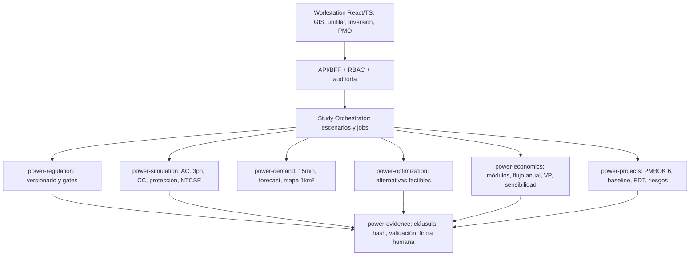

# PLAN MAESTRO UNITESIS V8 — MOTOR DE ESTUDIOS TÉCNICO-ECONÓMICOS Y GESTIÓN PMBOK 6

**Fecha de revisión**: 17 de octubre de 2026. **Estado**: arquitectura y scaffold con cálculos financieros elementales probados; no es producto regulatorio certificado.

## 0. Conclusión jurídica prioritaria
La R. 217-2013-OS/CD regula tarifas/compensaciones SST y SCT y define el PIT asociado. **No se debe tratar como PIDE**. Las normas y modificatorias requieren consolidación por artículo antes de usar requisitos automáticos. La RM 428-2017-MEM/DM publicó un proyecto PIDE; el Informe Legal 628-2025-GRT sostuvo que los criterios MINEM aún no estaban aprobados a esa fecha. El anexo B.1.2 de la R. 080-2012-OS/CD, incorporado por R. 264-2016-OS/CD, sí es el procedimiento separado. **No se identificó con certeza el texto completo del «Anexo 1» sustantivo de PIDE**; no se transcriben límites ficticios. La aprobación posterior a agosto 2025 no está acreditada en este plan.

## 1. Jerarquía de marcos de planificación
| Familia | Tipo y elegibilidad | Horizonte de la norma base y observaciones |
|---|---|---|
| PIT-SST-SCT | Área de Demanda y titulares elegibles SST/SCT; R217+modificatorias | Proyección de demanda 30 años (6.2.1); evaluación mínimo costo a 10 años (11.3); inversiones previstas para entrada en operación 4 años (10.2). Debe revisarse la versión consolidada. |
| PIDE | Empresas distribución bajo FONAFE y procedimiento B.1.2 | Los horizontes y criterios sustantivos se cargarán **solo con texto MINEM aprobado verificable**; en su ausencia, estudio interno sin certificación PIDE. |
| Estudios internos de distribución | Distribuidoras públicas/privadas; condicionados a CNE, NTCSE, reglamentos y normativa aplicable | Horizonte por proyecto, sin atribuir regla del PIT. |
| PMBOK 6 | Proyecto individual de inversión (independiente de marco tarifario) | Inicio, planificación, ejecución, monitoreo/control y cierre; 10 áreas; baseline CAPEX/costos y calendario. |

## 2. Arquitectura avanzada

### Capas y límites
1. **Dominio y políticas**: `power-regulation`, `power-economics`, `power-projects`. Pure Python, tipos fuertes, sin SDK LLM, web ni DB.
2. **Orquestación**: los estudios salen de snapshots inmutables. Una alternativa no hereda cambios de otra; jobs reintentables con `run_id`.
3. **Cómputo**: solver independiente de optimizador/ML/LLM; validación física final.
4. **Costos**: catálogos de módulos aprobados por fecha y moneda; pérdidas incremental vs base según norma.
5. **PMO**: historial de cambios, aprobaciones separadas, firma de ingeniero y responsable económico.
6. **Interfaz**: selector de norma, estudio, alternativas, matriz artículos, dashboard y exportación; drafts señalizados.
7. **Seguridad**: prohibición de cambios SCADA/contratos; acceso restringido a GIS y precios confidenciales.

## 3. Catálogo de 40+ estudios y sus entregables
El catálogo máquina legible se encuentra en `config/studies/catalog.json`; todas las funciones figuran como **especificadas, no implementadas**. Familias: Demanda; Eléctricos y calidad; Expansión; Económicos; Normativa y cartera. Pueden combinarse en un estudio regulatorio por área y periodo. El proyecto requiere análisis adicionales cuando sean pertinentes a NTCSE, CNE, IEC, IEEE o COES; no se infiere que TODOS sean obligatorios por R217.

## 4. Metodología concreta PIT
1. Definir Año Representativo, Área de Demanda, instalaciones existentes, red y cambios autorizados.
2. Importar 15-min y F-101/102/103/104/105/113; limpiar faltantes, origen y consistencia; sumar Usuarios Libres individualmente.
3. Pronosticar potencia/energía bajo supuestos rastreables, ajustar FC/FCP, desagregar por nivel y SET, mapas 1 km² (F-123).
4. Estudios sin proyecto y con alternativas (transferencia, rotación, nuevas SET/líneas, conductor, compensación si procede); iterar bajo límites técnicos.
5. Filtrar alternativas inviables, aplicar costos de módulos oficiales, O&M y pérdidas de potencia/energía correctamente valorizadas.
6. Calcular valor presente de costos por año con tasa y periodo **parametrizados por norma y fecha**; horizonte base 10 años, evitando confundir 30 años de demanda o 4 de ejecución.
7. Seleccionar mínimo costo total entre las factibles; elaborar trazabilidad y documentos (incluido formato F-201 cuando corresponda).
8. Dossier técnico-económico y verificación previa a revisión regulatoria con módulos de aprobación separados.

## 5. Metodología PIDE
1. Confirmar elegibilidad FONAFE y versión aprobada de criterios MINEM.
2. Anexo B.1.2 rige el **procedimiento**, no sustituye parámetros técnicos sustantivos.
3. Si no existe norma sustantiva verificable, ejecutar **estudio de distribución interno** con etiqueta inequívoca no certificada.
4. Generar candidatos: reconductorización, redistribución de cargas, nueva SED/alimentador, automatización, BESS/EV/DER, según contexto y normativa aplicable.
5. Aplicar estudios de pérdidas/cargabilidad/tensión/continuidad, costos y horizonte explícitamente configurado, sin trasladar automáticamente los 10/30/4 años de PIT.
6. Mantener bloqueo de exportación como «PIDE aprobado» hasta documento, comprobación y firma jurídica.

## 6. Alternativas técnico-económicas por norma
El conjunto de candidatos se encuentra en `config/regulations/alternatives.json`. **No todos constituyen requisitos legales**: siempre se documenta por qué sí/no es pertinente una alternativa. Regla de selección: primero factibilidad física/regulatoria, luego optimización económica; los algoritmos NSGA-II, MILP, MINLP, Monte Carlo o agentes son auxiliares, no fuente normativa.

## 7. Evaluación económica
- PIT R217 original art 11.3: VP(Inversión + Operación + Mantenimiento + pérdidas monetizadas). La pérdida relativa al primer año sin obra debe implementarse según texto íntegro cuando se consolide, evitando confundir gasto absoluto e incremental.
- Fuentes: módulos estándar aprobados y actualizados, precios de barras, índices y monedas; no inventar tarifas.
- Funciones de análisis interno separadas: VPN privado, TIR, beneficio/costo, ENS, sensibilidad de fechas, retraso comercial, carbono si política lo exige.
- Código entregado calcula VP genérico anual, filtro factible, tests; **no** tarifas oficiales, CMA ni peajes.

## 8. Gestión PMBOK sexta edición
Cada alternativa recomendada se convierte en objeto Proyecto con Charter/Acta, interesados, EDT/WBS, cronograma, presupuesto, matriz de calidad, recursos, comunicaciones, riesgos, compras, bitácora de cambios y cierre. Diez áreas, cinco grupos y matriz RACI. Plantillas en `templates/projects/PMBOK6/`. PMO mantiene línea base separada del ejercicio regulatorio de cálculo.

## 9. SDD, Worktrees y agentes especializados
Especificaciones `020` a `025`; cuatro skills especializados en `.agents/skills/`. Worktree por feature; pruebas contract, legal, engineering, integration, E2E y signoff. Docs para el agente en `docs/agents/V8-RESEARCH-SOURCES.md`. Los conectores son una propuesta de privilegios y no están conectados automáticamente.

## 10. Backend y frontend a implementar
Rutas propuestas en `docs/regulatory/UI-AND-API-BLUEPRINT.md`, sin endpoints implementados. Frontend desplegará GIS/Unifilar, panel de restricciones y comparativa de alternativas/PMBOK; posterior exportación PDF/Excel requiere comprobar el formato regulatorio vigente.

## 11. Criterios de aceptación cuantificables, aún pendientes
- 100 % de fuentes normativas requeridas por expediente con fecha y hash + verificación legal.
- 100 % de alternativas elegibles con resultados de solver y tolerancias justificadas (no números inventados).
- 100 % CAPEX de módulos con identificador/costo y año base vigente.
- Comparación independiente de flujos AC con benchmarks previamente aprobados.
- Evaluación VPN replicable en Python y Excel para datos sintéticos de control.
- 100 % proyecto recomendado con Charter, WBS, cronograma, riesgos y firmas asignadas.
- Cero estado «aprobado» por agente o draft PIDE; UI debe demostrar bloqueo.

## 12. Plan por fases
| Sprint | Entregable | Gate |
|---|---|---|
| R0 | Consolidar R217 con modificatorias y texto MINEM PIDE | validación legal |
| R1 | Implementación dominio/perfiles/reglas y catálogos | tests 100% reglas implementadas |
| R2 | Datos regulados: demanda 15min, F y módulos de costos | datasets y trazabilidad |
| R3 | Solver técnico y estudio alternativo con GIS | benchmarking AC |
| R4 | Economía PIT/PIDE interna + sensibilidad | conciliación financiera |
| R5 | Gestión PMBOK6 por proyecto y cartera | firmas de roles |
| R6 | UI, reportes y expedientes | UAT y E2E |
| R7 | Piloto con casos autorizados reales | aceptación legal/eléctrica/PMO |

## 13. Estado y evidencia de esta entrega
- Preservados todos los archivos V7 en ZIP V8.
- Nuevos módulos `power-regulation`, `power-economics`, plantillas PMBOK, regulaciones versionadas y test unitario; no afirmar desarrollo completo.
- `docs/regulatory/SOURCES.json` registra fuentes accesibles y estados; norma consolidada completa todavía pendiente.
- Ver pruebas `python -m unittest discover -s tests/bootstrap -v`.

## 14. Referencias primarias
- **R217**: Resolución 217-2013-OS/CD original. https://www.osinergmin.gob.pe/Resoluciones/pdf/2013/OSINERGMIN%20No.217-2013-OS-CD.pdf. *Uso*: SST/SCT, PIT, artículos 5-12 y módulos de costos; aplicar modificatorias.
- **R147**: Resolución 147-2017-OS/CD. https://www.osinergmin.gob.pe/Resoluciones/Resoluciones-GRT-2017.aspx. *Uso*: Modifica 217-2013; conciliación por artículo pendiente.
- **R018**: Resolución 018-2018-OS/CD. https://www.osinergmin.gob.pe/Resoluciones/Resoluciones-GRT-2018.aspx. *Uso*: Modifica 5.8.2 y 12.3; conciliación por artículo pendiente.
- **R177**: Resolución 177-2021-OS/CD. https://www.osinergmin.gob.pe/Resoluciones/Resoluciones-GRT-2021.aspx. *Uso*: Calendario histórico de modificación PIT 2021-2025, no reutilizar para 2025-2029.
- **R242**: Resolución 242-2021-OS/CD. https://www.osinergmin.gob.pe/Resoluciones/Resoluciones-GRT-2021.aspx. *Uso*: Modificatorias relativas a SST/SCT.
- **R080**: Resolución 080-2012-OS/CD y texto concordado. https://www2.osinergmin.gob.pe/Resoluciones/pdf/2012/OSINERGMIN%20No.080-2012-OS-CD.pdf. *Uso*: Anexos A.2.1/2 transmisión y B.1.2 distribución; verificar versión aplicable.
- **R264**: Resolución 264-2016-OS/CD. https://www.osinergmin.gob.pe/Resoluciones/pdf/2016/R_OSINERGMIN_No.264-2016-OS-CD.pdf. *Uso*: Incorpora Anexo B.1.2 para aprobación PIDE FONAFE.
- **RM428**: RM 428-2017-MEM/DM. https://www.datosperu.org/directorio-de-normas-legales-del-peru-2017-octubre-19-10-2017-pagina-10.php. *Uso*: Prepublica proyecto de criterios PIDE, no acredita aprobación.
- **IL628**: Informe Legal 628-2025-GRT. https://www.osinergmin.gob.pe/Resoluciones/pdf/2025/Informe-Legal-628-2025-GRT.pdf. *Uso*: En agosto 2025 criterios PIDE pendientes de aprobación; verificar cambios posteriores.
- **R112**: Resolución 112-2024-OS/CD y modificaciones. https://www.osinergmin.gob.pe/empresas/electricidad/transmision/plan-inversiones. *Uso*: PIT 2025-2029 y modificación 149-2024.
- **R2026**: Actualizaciones PIT 2026. https://busquedas.elperuano.pe/dispositivo/NL/2560029-1. *Uso*: Modificación Área 6 y ventanas de presentación mayo/junio/julio 2026 según Área.
- **MOD2026**: Base de Módulos Estándares 2026. https://www.osinergmin.gob.pe/Resoluciones/Resoluciones-GRT-2026.aspx. *Uso*: Costos 2025 actualizados por Res 008-2026 y 059-2026; comprobar versión por estudio.
- **VAD2026**: Términos VAD 2026-2030/2027-2031. https://www2.osinergmin.gob.pe/GRT/Procesos-Regulatorios/VAD-2026-2030_2027-2031/Anexo-T%C3%A9rminosVAD-2026-2030-2027-2031-R033-2026-OS-CD.pdf. *Uso*: Numeral 7.5 incorpora PIDE aprobado conforme metodología vigente; condicionado.
- **PMI6**: PMBOK Guide Sixth Edition + Agile Practice Guide. https://www.pmi.org/shop/p-/book/a-guide-to-the-project-management-body-of-knowledge-%28pmbok-guide%29-%E2%80%94-sixth-edition-and-agile-practice-guide-%28english%29/00101602400. *Uso*: 5 grupos, 10 áreas; artefactos UNITESIS, sin reproducir texto protegido.

## 15. Avisos contra inferencias de IA
La fuente consultada puede ser histórica, borrador o registro de proyecto. No reproducir contenido protegido PMBOK. Ningún agente puede modificar límites técnicos basándose en una publicación académica cuando la norma peruana específica exige otra cosa. No se confunde un plan aprobado PIT 2025–2029 con una reforma tarifaria posterior, ni procedimiento PIDE B.1.2 con aprobación de criterios sustantivos.

## 16. Complemento documental verificado: procedimiento PIDE y guías complementarias
- Se reconstruyeron los **17 hitos a–p** del Anexo B.1.2, incorporando la letra ñ, con responsables, plazos históricos y advertencia sobre versiones posteriores. Ver `docs/regulatory/PIDE-ANNEX-B1.2-PROCEDURE.md`.
- Plazo base de presentación según versión 2016: primer día hábil de octubre del segundo año anterior al de fijación VAD; audiencias, observaciones, aprobación y recursos tienen plazos relativos distintos. Nunca confundir plazo regulatorio con cronograma de ingeniería PMBOK.
- Se registra una **guía metodológica MINEM (2023)** sobre distribución, DER y nuevas tecnologías como documento técnico de apoyo, no como aprobación formal de criterios PIDE.
- Se agrega una tesis de la **Universidad Nacional de Ingeniería** de plan de inversión de distribución, como antecedente académico no vinculante.
- Los cambios normativos en las competencias de PIDE deben revisarse por año de vigencia (incluido DS 027-2018-EM y DS 028-2021-EM), no asumirse constantes.
- Las tres fuentes adicionales están en `docs/regulatory/SOURCES.json` con niveles de comprobación explícitos, pendientes de revisión completa de texto cuando corresponda.

## Adenda V8.1 — PIDE prepublicado confirmado en El Peruano
Leer `docs/regulatory/PIDE-2017-PREPUBLICACION-EL-PERUANO.md`; usar etapas de referencia histórica para distribución, separadas del expediente legal FONAFE y del PIT.

## Actualización V8.2 PIDE
Consultar `docs/regulatory/pide_2017/INDEX.md` para metodología respaldada por TDR 2018, registro de fuentes y bloqueos por anexo MINEM sin recuperar. El motor de anualización es únicamente ilustrativo; los estudios reales están pendientes.
