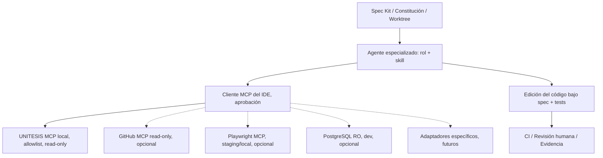

# Skills y conectores: integración SDD/MCP

## Modelo de capacidades

Los **skills** son procedimientos versionados para agentes; cumplen el estándar Agent Skills (`.agents/skills/<nombre>/SKILL.md` con frontmatter). No son conectores ni sustituyen permisos. Los **MCP servers** son interfaces hacia herramientas/datos; los **puertos de aplicación** son contratos de software y no dependen de MCP.

## Principios

1. Un skill define **cómo** realizar trabajo; MCP define **qué recurso** se puede invocar. No se debe convertir la instrucción de un skill en permiso efectivo.
2. Catálogo central `connectors/registry.json`: estado `implemented`, `optional` o `planned`. Las plantillas no prueban conexión ni autorización.
3. Tres niveles: L0 repositorio read-only; L1 entorno local/staging con herramientas; L2 producción con políticas y aprobación fuera del agente. Por defecto L0.
4. GitHub MCP debe arrancar en **read-only**; GitHub Write separado. Las PRs quedan tras autorización del humano.
5. PostgreSQL usa usuario sin INSERT/UPDATE/DELETE ni acceso a datos confidenciales; preferir ambiente efímero con datos sintéticos.
6. Playwright MCP o CLI solo para UI local/staging. Validar que no se ingrese PII real al navegador de pruebas.
7. El SDK MCP oficial es una dependencia **opcional de desarrollo**, no del dominio eléctrico ni backend de producción.
8. Servidores comunitarios deben someterse a revisión de publisher, licencia, riesgo de prompt injection, checksum y egress antes de instalar.

## Perfil backend

- Skills: `unitesis-backend-fastapi`, `unitesis-domain-ddd`, `unitesis-api-contracts`, `unitesis-db-postgis`, `unitesis-testing-qa`.
- MCP: `unitesis-project` (implementado, read-only), `github-readonly` (opcional), `postgres-readonly` (opcional, DB local).
- Flujo: spec → OpenAPI → modelo de dominio → use cases → adapters → router FastAPI → contract + RBAC tests → PR.
- Exigir OpenAPI versionada, errores tipados, autorización por tenant/acción/objeto, migraciones explícitas, idempotencia para comandos, patrón outbox y jobs asíncronos que no bloqueen la API.

## Perfil frontend

- Skills: `unitesis-frontend-react`, `unitesis-design-system`, `unitesis-api-contracts`, `unitesis-testing-qa`.
- MCP: `unitesis-project` (implementado), `playwright-local` (opcional), `github-readonly` (opcional).
- Flujo: spec UI → contrato API → componentes con roles ARIA → mapa y unifilar sincronizados → estados de error/stale → tests de componentes y E2E → revisión visual y PR.
- TypeScript `strict`, estado remoto separado de estado UI, IDs/snapshot inmutables y no duplicar las ecuaciones del solver en TypeScript.

## Plataforma eléctrica y entrenamiento

- GIS/Graph: conector de catálogo de datos autorizado, manifiestos y querys read-only de snapshot.
- Simulación: futuro MCP con tools `validate_case`, `run_study_sandbox`, `read_result` y job_id. Solo casos clonados y recursos acotados; primero se implementa PowerFlowPort sin MCP.
- SciML/MARL: lectura de metadata de modelos; entrenamiento y RL como jobs en entorno aislado con quotas. Nunca usar un endpoint MCP genérico que ejecute Python arbitrario.
- Blockchain: consulta read-only de prueba; no exposición de claves privadas; ledger no decide factibilidad.

## Conectores: ciclo de vida

`discover -> vendor security review -> permission design -> sandbox install -> contract test -> audit -> opt-in enable -> revoke/rotate`.

## Compatibilidad con IDEs

- Cursor: skills compartidos `.agents/skills`, proyecto `.cursor/mcp.json`. **Ya se incluye solo MCP local**, no externos.
- VS Code/Copilot: `.mcp.json` portable generado por `scripts/agents/bootstrap_mcp.py --target vscode`; las skills de GitHub Copilot pueden sincronizarse a `.github/skills` mediante script.
- Codex: `.agents/skills` puede ser reconocido según cliente; comprobar versión efectiva e integración SDD.
- Claude Code: sincronizar a `.claude/skills` con script; luego habilitar MCP usando instrucciones del cliente.
- Otras herramientas: copiar/sincronizar skill folders según documentación; MCP stdio es un estándar abierto, pero hay diferencias de sintaxis entre clientes.

## Checklist de PR de agente

- [ ] Especificación y worktree correctos; no archivos de otras ramas.
- [ ] Herramientas habilitadas identificadas y permisos mínimos.
- [ ] Sin credenciales, datos reales ni tokens en diffs/logs.
- [ ] Pruebas funcionales, contratos, límites y errores ejecutados.
- [ ] API y frontend no tienen derivaciones incompatibles del modelo.
- [ ] Validación eléctrica por solver cuando aplica.
- [ ] Evidencias, notas de instalación y riesgos restantes.

### Perfiles `.github/agents` disponibles

Se incluyen `unitesis-architect`, `unitesis-backend`, `unitesis-frontend` y `unitesis-qa` para VS Code/GitHub Copilot. Se configuran herramientas básicas `read/search/edit`; verificar soporte efectivo del harness y no considerarlas un firewall. Los otros ocho perfiles siguen disponibles en `connectors/registry.json` para generar agentes adicionales.

Cursor Worktrees: `.cursor/worktrees.json` ejecuta solo validaciones locales de estructura y skills, sin copias de credenciales ni instalaciones automáticas.
