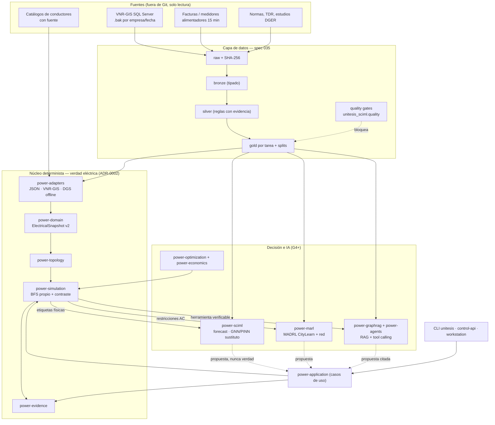

# Arquitectura integral — sincronizada con specs, módulos y datos

**Estado:** referencia vigente y única del proyecto (revisada el 21/10/2026).
**Regla de lectura:** cada capacidad tiene **una** spec dueña, **un** paquete dueño, **una** fuente de datos declarada y **un** estado verificable. Si alguno de los cuatro falta, la capacidad no existe todavía.

## 0. Producto universal y casos de aplicación

UNITESIS es universal: el código no contiene supuestos de país, empresa, frecuencia, CRS, moneda ni norma. Lo local se declara en tres registros sincronizados, validados por `unitesis_config.cases.check_consistency`:

| Registro | Archivo |
|---|---|
| Caso de aplicación | `config/cases/<case_id>.json` (plantilla `_template.json`) |
| Fuentes de datos (`case_id`, `role`) | `config/datasets/sources.v2.json` |
| Perfiles regulatorios por `jurisdiction` | `config/regulations/profiles/*.json` |

**Caso piloto de aplicación:** `pe-ica-electrodunas` (Electro Dunas: Ica, Chincha, Pisco, Nasca). Genera datasets y pruebas con datos reales que validan el producto. Los datos de otras localidades de proyectos previos (p. ej. Iquitos) son `method_reference`: sirven para desarrollar métodos y nunca son evidencia de un caso. Un caso nuevo se agrega copiando la plantilla, sin cambiar código.

## 1. Puertas de calidad (constitución) y nomenclatura

| Puerta | Significado (`.specify/memory/constitution.md`) | Estado |
|---|---|---|
| G0 | repositorio, pruebas, contratos | **cumplida** (suites unit, contract, integration, security y governance; `verify_structure.py`) |
| G1 | ingesta sin pérdida, manifiestos raw, invalidación | **parcial**: JSON neutral sí; VNR-GIS no (spec 001) |
| G2 | consistencia topología ↔ GIS ↔ unifilar | **parcial**: topología radial sí; GIS no (spec 003) |
| G3 | benchmark de flujo de potencia y validación independiente | **cumplida para el alcance radial equilibrado** (BFS propio frente a pandapower, diferencias ≤ 1e-11) |
| G4+ | optimización e IA, solo con las puertas anteriores en verde | optimización de conductores operativa; PINN/MADRL/LLM **bloqueados por datos** (spec 035) |

**Corrección de nomenclatura:** "trifásico desbalanceado" no es G3; es la capacidad 008-C de la spec 008. En adelante, G3 se califica por alcance: `G3[radial-equilibrado]` cumplida y `G3[trifásico-desbalanceado]` pendiente.

## 2. Capas y regla de dependencia



Reglas inamovibles: `power-domain` solo usa la stdlib. Toda salida de IA vuelve a pasar por el solver propio antes de mostrarse como resultado (ADR-0002). Ningún módulo escribe en la topología fuente. Los motores propietarios están excluidos (ADR-0010).

## 3. Matriz sincronizada spec ↔ módulo ↔ datos ↔ estado

Numeración canónica: las 40 specs del plan maestro (decisión del usuario, 21/10/2026). Las equivalencias con la numeración anterior están en [`SPEC-ID-MIGRATION.md`](../traceability/SPEC-ID-MIGRATION.md). Estados: **operativo** (código, pruebas y uso por CLI/API), **parcial**, **scaffold** (solo estructura), **pendiente** (spec sin código). El detalle por tarea vive en `specs/<id>/tasks.md` y en [`master-backlog-assessment.csv`](../traceability/master-backlog-assessment.csv).

| Spec | Capacidad | Paquete dueño | Datos | Estado |
|---|---|---|---|---|
| 000 | repo, CI, contratos | raíz, `tests/governance`, `scripts/verify_structure.py` | — | operativo |
| 001 | ingesta de redes reales (VNR-GIS, CYME ASCII) | `power-adapters`, `power-application.network_import` | TXT CYME, MDB y `.bak` VNR del caso | parcial: CYME ASCII operativo (93 leídos, 44 validados); VNR-GIS y MDB pendientes |
| 002 | nueva carga | `power-application.study` | snapshot | parcial: cribado equilibrado operativo; por fase depende de 008-C |
| 003 | GIS ↔ unifilar | `power-topology`, `apps/control-api` (`networks.py`), `apps/workstation-web` (`map.js`) | geometría `.geo.json` por alimentador | parcial: unifilar y router de geometría; integración en la UI pendiente |
| 004 | runtime fullstack | `apps/`, `scripts/unitesis.py`, `infra/` | — | parcial: CLI, API y workstation locales; frontend React pendiente |
| 005 | identidad, tenant y autorización | `apps/control-api` | — | parcial: bearer local con roles y tenant; OIDC pendiente |
| 006 | modelo eléctrico canónico | `power-domain` | snapshots v2/v3 | operativo: `ElectricalSnapshot` con identidad numérica estable |
| 007 | jobs durables y eventos | `power-adapters`, `power-application` | SQLite / PostgreSQL local | parcial: jobs durables y worker; recuperación distribuida pendiente |
| 008 | solvers AC y validación | `power-simulation`, `power-topology` | snapshots, benchmarks | parcial: BFS, Newton-Raphson (radial/mallado), transformadores y trifásico desbalanceado propio (008-C, IEEE 13 contra valores publicados) operativos; IEEE 123, Dyn y lectura CYME por fase pendientes |
| 009 | escenarios y modelo temporal | `power-application`, `power-sciml` | perfiles | parcial: escenarios de carga declarados en datasets PF |
| 010 | grafo eléctrico | `power-graph` | — | scaffold |
| 011–013 | P2P, ledger, mercado P2P | `power-p2p`, `power-ledger`, `power-market` | — | scaffold |
| 014 | GraphRAG técnico | `power-graphrag` | corpus con licencia | pendiente |
| 015 | skills, agentes y MCP | `.agents`, `connectors`, `tools/mcp` | — | parcial: SDK y handshake stdio probados |
| 016 | pronóstico de demanda y perfiles | `power-sciml.datasets` | medidores del caso | parcial: splits cronológicos y controles; modelos pendientes |
| 017 | cortocircuito, calidad y confiabilidad | `power-simulation` | — | pendiente |
| 018 | alternativas de planificación | `power-optimization`, `power-economics` | catálogos, base económica | parcial: alternativas de conductor con VPN y capacidad remanente certificada |
| 019 | optimización multiobjetivo | `power-optimization.pareto` | — | parcial: frente de Pareto y factor de emisión declarado |
| 020–025 | regulación PIT/PIDE, PMBOK, UI regulatoria, monitor | `power-regulation` | `config/regulations` | registro documental; cálculos no iniciados |
| 026–027 | PIDE metodológico y auditoría | `power-regulation` | fuentes PIDE | parcial: anualidad ilustrativa y bloqueos |
| 028 | DER, BESS, EV y renovables | `power-optimization` | — | pendiente |
| 029 | SciML GNN/PINN | `power-sciml`, `workers/ml-training` | `pf-scenarios-<case_id>` desde redes reales | parcial: destilación maestro → alumno, validación cruzada por alimentadores y dominio de validez; el cribador físico truncado (3 iteraciones) pasa AC-029-S02 en 0,015 ms por escenario y el GNN solo no lo supera (AC-029-S06); IA reorientada a redes malladas, de fases y multiescenario |
| 030 | MARL y agentes LLM | `power-marl`, `power-agents` | `district-flex-<case_id>`, corpus | pendiente |
| 031 | seguridad, observabilidad y operación | `apps/control-api`, `scripts/dev` | — | parcial: telemetría y respaldo local |
| 032 | informes y evidencia | `power-evidence` | — | parcial: sobre de evidencia con publicación atómica |
| 033–034 | cartera de inversión; generación y transmisión | — | — | pendiente |
| 035 | federación de datos autorizada | `power-config.cases`, `power-sciml.quality`, `scripts/datasets` | registro de fuentes v2 | parcial: controles operativos; fuentes pendientes de lector o restauración |
| 036 | catálogo de tarifas y costos | `config/catalogs` | catálogos con fuente | parcial: catálogo de conductores |
| 037 | interoperabilidad DGS/MDB/SQL | `power-adapters` | — | parcial: CYME ASCII y su estructura recuperada (REA, ADR-0012); MDB y SQL pendientes |
| 038 | benchmarks y reproducibilidad | `benchmarks/`, `scripts/benchmarks` | fixtures sintéticos | parcial: benchmark de flujo de potencia y línea base SciML |
| 039 | release y gobierno de producción | — | — | pendiente |

## 4. Pipelines de datos por capacidad

### 4.1 VNR-GIS → ElectricalSnapshot (001, prerrequisito de 029)

El esquema VNR-GIS es un formato estándar de las distribuidoras peruanas: el adaptador es por formato y versión, no por empresa. Relevado sobre una base VNR ya restaurada en la instancia local (solo metadatos); las cifras se confirmarán sobre el backup del caso piloto al restaurarlo:

| Elemento VNR | Tabla y campos | Uso | Brecha |
|---|---|---|---|
| Alimentador MT | `mtSalida` (`CodSalidaMT`, `CodSet`, `CodTenNomi`, `MaxDemRegistrada`) | slack y demanda de cabecera | código de tensión → kV por tabla de códigos |
| Tramo MT | `mtTramo` (`CodTramoMTPadre`, `Longitud`, `CodNorma`, `CodTipoCircuito`) | líneas; conectividad explícita padre → hijo (raíz = padre `'0'`) | **no hay R/X**: `CodNorma` solo describe material y sección ("AA 3x10 mm2") |
| Geometría | `verTramoMT` (vértices UTM) | GIS (003), no conectividad | zona UTM/CRS no declarada en la base |
| SED MT/BT | `Sed` (`PotInstalada`, `MaxDemTotal`, `CodSalidaMT`) | cargas agregadas y trafos | sin P/Q ni perfil horario; sin impedancia de trafo |
| Equipos | `mtEquipo` (`CodEstadoOperacion` NC/NA) | interruptores y estado | NA/NC → `closed` por regla documentada |
| BT | `btTramo`, `btSalida`, `Suministro` | red secundaria | fuera del primer corte |

Calidad observada: 15 304 tramos MT, 92 alimentadores, 106 raíces (hay alimentadores con varias raíces o islas: control G1/G2), 42 normas de conductor y 6 SED sin demanda.
Regla: el mapeo `CodNorma` → conductor del catálogo y la geometría (DMG) se registran como tabla versionada con fuente. Lo que no se pueda mapear va a cuarentena y no se completa por defecto.

### 4.2 Capa PINN / GNN sustituto (029)

Objetivo: un **aproximador rápido** del flujo de potencia y del estado de la red (tensiones y cargabilidad) para cribar miles de escenarios: planificación, MADRL y nueva carga. Nunca reemplaza al solver propio (ADR-0002).

```text
redes reales TXT (CYME ASCII) + MDB + VNR-GIS (001) ──► snapshots por alimentador
     (topología real; R/X del catálogo real BD_Equipo mapeado a CodNorma; IEEE solo valida el motor)
     │
     ├─► generador de escenarios (009/035): demanda por SED = MaxDemTotal × perfil (forecast gold)
     │     × factor de potencia declarado como supuesto de escenario; cambios de topología N-1
     ▼
solver propio (008-A) ──► etiquetas: V, ángulo, I, pérdidas, convergencia (descarta no convergentes)
     ▼
dataset gold `pf-scenarios` (grafo por muestra + etiquetas + hash de snapshot)
     ▼
entrenamiento GNN con pérdida física (residuo de balance de potencia AC sobre la Y-bus propia)
     ▼
validación: error en p.u. por nodo, residuo KCL, OOD por alimentador no visto; contraste
en una muestra por pandapower/solver propio; el modelo solo prioriza, el solver confirma
```

Decisiones de experto incorporadas:

- **Split por alimentador, no aleatorio.** Si un mismo alimentador aparece en train y en test, el modelo memoriza la topología. Los 92 alimentadores se dividen en grupos disjuntos para estimar el error fuera de distribución.
- **La pérdida física se calcula con la Y-bus del dominio propio**, no con otra implementación paralela. Así el residuo se mide igual que en el solver.
- **Destilación (ADR-0011):** el solver es el maestro físico; un GraphSAGE grande, el maestro modelo; el alumno pequeño aprende de ambos y del residuo AC, también en escenarios sin etiquetar. Siempre se compara con un alumno del mismo tamaño sin maestro (`distill-pf-surrogate`).
- **"PINN" en sentido estricto** (resolver EDP con autodiferenciación) no aplica al flujo estacionario. Lo correcto aquí es un *GNN informado por la física* (residuo AC como regularizador) y, para dinámica, PINN de transitorios en una fase posterior. La spec 029 lo distingue para no prometer lo que el método no da.
- Dependencia de software: `torch` autorizado por el usuario el 21/10/2026 (`requirements/torch-cuda124.txt`).

### 4.3 MADRL (030)

`district-flex-<case_id>` (035; piloto construido con clientes importantes, medidores y exógenas reales de Electro Dunas; sin oráculo; splits por año) → entorno CityLearn → **acople a red**: cada edificio se asigna explícitamente a una barra del snapshot. Las violaciones de tensión o cargabilidad del solver (o del sustituto 029, confirmado por el solver) entran en la recompensa y en la restricción. Algoritmos de referencia: HAPPO, MAPPO, MASAC y MATD3 frente a una línea base basada en reglas. Ninguna política actúa sobre SCADA (spec 031 y constitución).

### 4.4 LLM (030)

No se preentrena ni se ajusta un modelo con datos de clientes. Hay tres activos:

1. **Corpus RAG** de normas, specs y ADR con fragmentos citables, licencia por documento y versión.
2. **Herramientas tipadas**: la CLI y la API (`study`, `new-load`, `alternatives`, `verify-evidence`).
3. **Trazas y evaluación generadas por el sistema**: las respuestas numéricas las produce el solver, no el LLM; las preguntas sin fuente esperan "no fundamentado".

El ajuste fino (SFT/LoRA) de un modelo local solo se hace sobre las trazas de herramientas, y solo si la evaluación muestra una mejora frente a RAG + tool calling.

### 4.5 Forecast de demanda (016, insumo de 029 y 030)

`feeder-load-15min-<case_id>` gold (piloto: medidores P/Q 2023‑2026, líneas L‑6605/6606 y cabeceras de Electro Dunas, con las exógenas aprobadas de Ica) → `unitesis_sciml.datasets` (ya operativo: splits cronológicos con hueco y manifiesto) → modelos base (persistencia estacional, CatBoost de Prodma adaptado) → perfiles para los escenarios de 029/030.

## 5. Ruta crítica (orden obligatorio)

1. **008-B1 Newton-Raphson y Y-bus compartida**: hecho (benchmark IEEE 33 radial y mallado).
2. **001 lectores de redes reales**: TXT CYME ASCII (fuente ya auditada: 96 alimentadores), luego MDB (requiere lector Access autorizado) y VNR-GIS (restaurar el `.bak`). Incluye el mapeo `BD_Equipo` ↔ `CodNorma` para la R/X real.
3. **008-B2 transformadores**, necesarios para alimentadores reales MT/BT.
4. **035 autorización y datos gold** (medidores, perfiles, pronósticos causales).
5. **029 GNN informado por la física** entrenado con las redes reales del caso; **030 MADRL** acoplado a red; **018/019 planificación**: el sustituto criba y el solver confirma.
6. **030 LLM** con citas y herramientas; **004/005/007/031 industrialización** antes de cualquier uso compartido.

## 6. Reglas de sincronización (una fuente de verdad por concepto)

| Concepto | Fuente única | Prohibido |
|---|---|---|
| Identidad eléctrica | `ElectricalSnapshot.content_sha256` (v2) | usar `NetworkSnapshot` v1 (legado, retirada en T006-A4) como identidad de estudio |
| Topología | `power-topology` sobre el snapshot | inferir conectividad por proximidad GIS (ADR-0003) |
| Parámetros de conductor | `config/catalogs/conductors/*.json` con fuente | defaults, o R/X dentro de redes neuronales |
| Datos de entrenamiento | manifiestos gold de la spec 035 por `case_id` | entrenar con archivos sueltos; mezclar casos o referencias de método |
| Supuestos locales | `config/cases/` + perfiles por jurisdicción | constantes de país o empresa en el código |
| Resultado eléctrico | solver propio + contraste + evidencia | resultados de GNN, MADRL o LLM sin confirmación |
| Entrenamiento de IA | cadena maestro → alumno con procedencia (ADR-0011) | destilar salidas de herramientas propietarias o de maestros sin licencia para entrenar |
| Formatos y métodos heredados | ingeniería inversa acotada con evidencia (ADR-0012) | descompilar programas propietarios o asumir códigos no deterministas |
| Estado de capacidades | esta matriz (§3) + `tasks.md` de cada spec | README o planes que contradigan la matriz |
