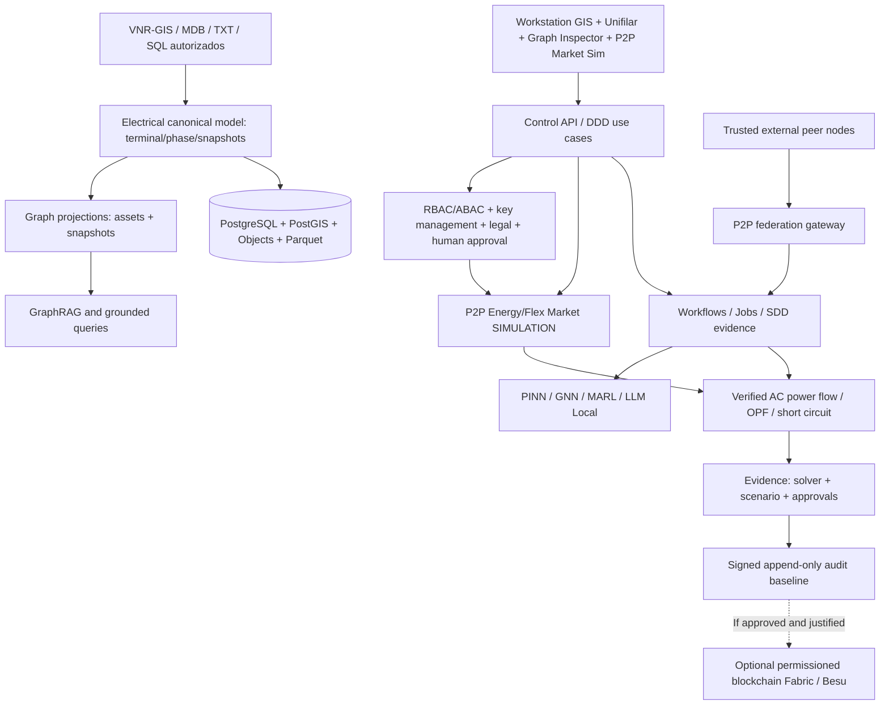

# UNITESIS Power Intelligence — Arquitectura integral Graph + P2P + Blockchain V5.0

**Fecha:** 17/10/2026 · **Version:** V5.0 · **Estado:** **arquitectura y scaffold inicial con pruebas de arranque, no plataforma comercial**.

**Continuidad:** este documento amplía —sin sustituir ni deshacer— la V4 de arquitectura modular GitHub Spec Kit + Git worktrees y las V2/V3 de planificación de sistemas eléctricos. El ZIP incluye `docs/reference/REPO_ARCHITECTURE_V4.md` y `docs/reference/ARCHITECTURE_V3_BASELINE.md`, además de SDD 000–014.

## 1. Alcance y decisión estratégica

La palabra **P2P** se implementa como dos bounded contexts diferentes y **Graph** como cuatro proyecciones disjuntas:

| Término | Uso real en UNITESIS | Separación obligatoria |
|---|---|---|
| Peer-to-Peer Communication | Compartir evidencias, propuestas y manifestos entre nodos de empresas/laboratorios autorizados | Transporte no implica comercio eléctrico ni conectividad física |
| Peer-to-Peer Energy/Flexibility | Mercado local simulado entre prosumidores DER, EV, BESS, microredes y recursos flexibles | La física AC y normativa restringen cada oferta |
| Electrical Graph | Modelo canónico por equipo–terminal–fase–conectividad–estado de interruptor | No se deriva únicamente por proximidad GIS |
| Asset/Knowledge Graph | Activos, proyectos, documentos, regulación, estudios, evidencia, linaje y GraphRAG | Proyección read-only con referencias versionadas |
| Peer Overlay Graph | Descubrimiento, sesiones y relaciones de confianza entre nodos informáticos | No representa líneas MT/BT |
| Market Graph | Agentes, contratos simulados, nodos eléctricos, ofertas y asignaciones | No determina por sí solo flujos eléctricos |
| Blockchain | Hashes, sello lógico y evidencia de transacciones autorizadas | Off-chain-first, **opcional**, nunca solver ni SCADA |

**Decisión V5:** implementar primero un **registro append-only verificable** y un **grafo derivado** desde el modelo maestro. Solo considerar Neo4j/Hyperledger Fabric/Besu/libp2p cuando los benchmarks y el caso de confianza lo justifiquen. La robustez no se obtiene añadiendo tecnologías sin necesidad.

## 2. Arquitectura de alto nivel



Plano de control: control-api, workflows, aprobaciones y proyectos. Plano de datos: `power-domain`, `power-topology`, PostGIS, source manifests y eventos. Plano de cálculo: solvers, SciML/GNN/MARL/optimización y workers. Plano de colaboración: `power-p2p`, `power-market`, ledger adapter. Plano de confianza: seguridad, evidencia, auditoría y pruebas negativas.

### 2.1 Consistencia y eventos

- El **maestro es el `NetworkSnapshot` inmutable** y su `topology_hash`, no la base de grafo ni blockchain.
- Cada proyección y propuesta incluye `tenant_id` + `network_snapshot_id` + `schema_version` y, cuando corresponda, `topology_hash`.
- Integración via patrón **transactional outbox/inbox**; delivery at-least-once, consumo idempotente, retriable DLQ y reconstrucción de proyecciones.
- Cambios de topología deben crear snapshot nuevo; una proyección obsoleta no es aceptable para validar un estudio actual.
- AC solver es **autoridad para factibilidad eléctrica**; GNN/PINN pueden ayudar a explorar pero requieren verificación final independiente.

## 3. Decisiones técnicas obligatorias (ADRs)

1. **ADR-0004:** separar `G_el`, `G_asset`, `G_p2p`, `G_market`; prohibido inferir conectividad por coincidencia de coordenadas.
2. **ADR-0005:** separar networking P2P de comercio P2P; no SCADA/protecciones; seguridad de peers y autorizaciones.
3. **ADR-0006:** blockchain permissioned **si y solo si** hay entidades independientes que necesitan consenso compartido; hashes fuera de cadena, benchmark contra registro firmado central.

### 3.1 Graph: motor, bases y razonamiento

- Core `power-topology`: grafo multifase eléctrico como entidad de dominio + estados de interruptor; armonización progresiva con perfil IEC CIM seleccionado y mapeos verificables.
- `power-graph`: read models de relaciones, subgrafos, rutas, alimentadores, dependencias y análisis de conectividad. MVP: Python NetworkX para estudios en memoria + PostgreSQL/PostGIS para persistencia espacial y versionado.
- Neo4j/Graph Data Science es **una opción posterior** sujeta a pruebas de escala, soporte, licencias, seguridad y costo.
- `power-graphrag`: resolución de cuestiones técnicas con documentos indexados, relaciones de activos y fuente evidenciable por URI/document hash; nunca reemplaza pruebas eléctricas ni inventa valores. Red-team de prompt-injection obligatorio.
- `power-sciml`: GNN temporal/heterogénea/PINN para inferencia sobre el grafo físico **solo** si supera referencia solver y baselines estadísticos, con OOD/uncertainty y cobertura topológica explícita.

### 3.2 P2P: transporte y federación de datos

- `power-p2p`: identidad criptográfica, TLS de servicio, ACL tenants/peers, discovery aprobado, firmas verificadas, TTL, no replays, hash de payload, inbox/outbox, cuotas y sincronización parcial.
- Baseline servicio cliente-servidor + broker durable; comparar libp2p para edge/malla (GossipSub, peer routing) sin asumir que sustituye autenticación/autorización del dominio.
- Compartir solo datos clasificados y consentidos; PII, curvas identificables y topologías protegidas con ACL y requisitos contractuales.
- Nunca emitir maniobras sobre equipos productivos ni interferir con protocolos de protección.

### 3.3 Mercado energético simulado

- `power-market`: ofertas por intervalo (15 minutos o ajuste configurable), generación DER, consumo EV, BESS SOC y límites físicos.
- `market-clearing` produce **propuesta**, ejecuta análisis AC/OPF de seguridad, compara costos/beneficios y rechaza opciones inviables.
- Pérdidas y cargos de uso de red, tensión, capacidad térmica, congestión, privacidad, garantías y contrato deben estar en el modelo.
- `mode=simulation` predeterminado; una fase `authorized-pilot` exigiría permisos y sistemas comerciales/medición habilitados (no presentes aún).

Objetivo orientativo para investigación, no sistema ya implementado:

\[
\max \sum_{t}\Big[\sum_b U_{b,t}(q_{b,t})-\sum_s C_{s,t}(q_{s,t})-C_{\mathrm{loss},t}-C_{\mathrm{congestion},t}-C_{\mathrm{tx},t}\Big]
\]

Con restricciones de flujo AC, límites de tensión y térmicos **aplicables según regulación**, capacidad disponible, balance energético, BESS SOC, EV, congestión y derechos de comercialización. Resolver mediante optimización externa y validar por solver. Los smart contracts solo registran aceptación/autorizaciones y no calculan flujo de potencia.

### 3.4 Blockchain

| Alternativa | Ventaja potencial | Principal costo/riesgo | Decisión |
|---|---|---|---|
| Audit log firmado central | Menor complejidad, buen baseline | Confianza en operador central | Primero |
| Hyperledger Fabric | Endorsement entre organizaciones, colecciones privadas | Gobernanza y operación de red | POC condicionada |
| Hyperledger Besu QBFT | Ethereum-compatible EVM, validators autorizados | Administrar mínimo 4 validadores para BFT, seguridad de contratos | POC condicionada |

Permanecen **off-chain**: datos de clientes, VNR-GIS confidencial, cargas SCADA, PDFs completos, matrículas/medidas identificables, series temporales y archivos de entrenamiento. En el ledger guardar exclusivamente referencias mínimas y hashes/compromisos criptográficos según análisis de privacidad. Un hash no prueba que el contenido original fuera verdadero; se requiere integridad del origen y validación técnica independiente.

**No tokenización/criptomonedas obligatorias.** La simulación de comercio P2P puede ejecutarse completamente sin blockchain.

## 4. Árbol modular integrado en el monorepositorio V4

Los directorios siguientes **ya están dentro del ZIP V5**. Se preservan todos los módulos V4 (GIS, PowerFactory/CYME converters, solvers, optimizer, SciML, MARL, agentes, GitHub/worktrees), sin sustituirlos.

```text
unitesis-power-intelligence/
├── .github/
│   ├── workflows/scaffold-ci.yml
│   └── CODEOWNERS
├── .specify/memory/constitution.md      # principios X: Graph/P2P/Ledger
├── .cursor/rules/
├── specs/
│   ├── 000-repository-foundation/
│   ├── 001-vnrgis-ingestion/
│   ├── 002-new-load-impact/
│   ├── 003-gis-unifilar/
│   ├── 010-electrical-graph/{spec,plan,tasks}.md
│   ├── 011-p2p-federation/{spec,plan,tasks}.md
│   ├── 012-ledger-evidence/{spec,plan,tasks}.md
│   ├── 013-p2p-energy-market/{spec,plan,tasks}.md
│   └── 014-graphrag-knowledge/{spec,plan,tasks}.md
├── packages/python/
│   ├── power-domain/                  # dominio puro
│   ├── power-topology/                # única topología canónica
│   ├── power-simulation/              # solver / benchmark
│   ├── power-optimization/            # MILP/MINLP/NSGA
│   ├── power-sciml/                   # PINN/GNN
│   ├── power-marl/                    # CTDE / reinforcement learning
│   ├── power-agents/                  # agentes LLM
│   ├── power-evidence/                # evidencia y audit trails
│   ├── power-graph/                   # Graph projection / queries
│   ├── power-graphrag/                # GraphRAG grounded
│   ├── power-p2p/                     # identidad y federation
│   ├── power-ledger/                  # hash/anclaje opcional
│   └── power-market/                  # flexibilidad/comercio simulado
├── apps/workstation-web/src/features/
│   ├── gis/                          # georreferenciado
│   ├── one-line/                     # unifilar
│   ├── graph-inspector/
│   ├── graphrag/
│   ├── p2p-federation/
│   ├── p2p-market/
│   └── ledger-evidence/
├── workers/
│   ├── ingestion/
│   ├── simulation/
│   ├── optimization/
│   ├── ml-training/
│   ├── agent-runtime/
│   ├── graph-projection/
│   ├── graph-retrieval/
│   ├── p2p-sync/
│   ├── market-clearing/
│   └── ledger-anchoring/
├── contracts/
│   ├── events/P2P-AND-LEDGER-EVENTS.md
│   └── schemas/json/
│       ├── graph-projection.v1.schema.json
│       ├── p2p-envelope.v1.schema.json
│       ├── p2p-energy-trade.v1.schema.json
│       └── ledger-anchor.v1.schema.json
├── infra/
│   ├── compose/ledger-dev/            # solo plantilla, sin nodos vivos
│   ├── compose/graph-optional/
│   └── security/{peer-pki,ledger-keys}/
├── benchmarks/{graph-projections,p2p-network,blockchain-ledger,market-clearing}/
├── fixtures/{graph-projections,synthetic-p2p-market,p2p-invalid-messages}/
├── docs/
│   ├── architecture/
│   │   ├── GRAPH_P2P_BLOCKCHAIN_V5.md
│   │   ├── decisions/ADR-0004-separate-four-graph-models.md
│   │   ├── decisions/ADR-0005-p2p-split-transport-market.md
│   │   ├── decisions/ADR-0006-ledger-optional-offchain-first.md
│   │   └── threat-model/THREAT-P2P-LEDGER-GRAPH.md
│   ├── development/SDD-WORKTREE-V5.md
│   └── traceability/FEATURE-MAP.md
└── tests/bootstrap/test_v5_graph_p2p_ledger.py
```

## 5. Plan de ejecución Spec-Driven Development

| Feature | Orden | Dependencias técnicas | Entregable | Gate de cierre |
|---|---|---|---|---|
| `010-electrical-graph` | tras 001/003 | Canonical topology + VNR-GIS | grafo por snapshot + consultas, provenance | 0 aristas huérfanas, tenant ACL, replay de snapshot |
| `011-p2p-federation` | tras 010 y control RBAC | Identidades, mensajes versionados | intercambio seguro de evidencia y propuestas | mensajes falsos/repetidos/expirados rechazados |
| `012-ledger-evidence` | paralelo a 011 (después de evidence) | Hashes, EvidenceStore, aprobaciones | log firmado + opción ledger POC | detección manipulación, disponibilidad de estudios sin blockchain |
| `013-p2p-energy-market` | solo tras 004 solver validado | AC solver, cargas DER/EV/BESS | mercado simulado física-constrained | trade inviable descartado, aprobaciones y medición obligatorias |
| `014-graphrag-knowledge` | tras 010 + 008 LLM | document store + ACL | consulta técnica explicable con citas | evidencias válidas y protección injection |

**Responsables:** GitHub CODEOWNERS iniciales y revisores humanos para seguridad, electricidad, regulación, ML, infraestructura. En features 011–013 se exigen revisiones interdisciplinarias y threat modeling documentado. No crear worktrees o aplicar merges automáticos sin review.

**Worktree nativo recomendado (Windows PowerShell):**

```powershell
cd unitesis-power-intelligence
python scripts/verify_structure.py
python -m unittest discover -s tests/bootstrap -v

# Solo luego de git init + commit inicial:
python scripts/dev/worktree.py new 010-electrical-graph
python scripts/dev/worktree.py new 011-p2p-federation
python scripts/dev/worktree.py new 012-ledger-evidence
```

Si `Spec Kit` ya creó la rama, usar `attach` en lugar de `new` para evitar colisiones. Abrir cada directorio hermano en un Cursor distinto, seguir `spec.md` → `plan.md` → `tasks.md` → pruebas → PR → revisión → merge. No inicializar Spec Kit en cada worktree.

## 6. Criterios para un piloto industrial (por definir en benchmarks)

- Simulación reproducible de redes alimentador IEEE 33/123 y casos sintéticos de VNR-GIS con escenarios carga/DER/BESS/EV.
- Calcular diferencia de resultados entre baseline AC y heurísticas/ML; cualquier candidato fuera de tolerancia se revalida o rechaza.
- Proyectar consultas Graph con p95, RAM, recálculo incremental, límites de nodos y concurrencia; fijar cifras tras medición en entorno objetivo.
- Probar P2P en partición de red, nodos no confiables, replay, falsificación de mensajes, pérdida y desorden de eventos; medir latencia end-to-end y recuperación.
- Evaluar Fabric y Besu bajo carga/caída de nodos; medir TPS, retardo a confirmación, capacidad, privacidad, coste de administración y exclusión de datos sensibles.
- Ensayar market clearing AC con pérdidas y seguridad, equidad y costo; comparar sin intercambio P2P y contra optimización central.
- Auditoría y verificación legal peruana **antes** de habilitar cobros o transacciones reales.

## 7. Estado exacto de los entregables V5

**Creados:** cinco paquetes y límites (con archivos de empaquetado), cinco features SDD completas `spec/plan/tasks`, cuatro JSON schemas, tres ADRs, documento de arquitectura, threat model, worktree guide, nuevo árbol de carpetas GUI/workers/infra, helpers de verificación de grafo físico derivado y SHA-256 local y guardas de simulación; tests/bootstrap extendidos e integrados con CI existente.

**Ejecutado:** `scripts/verify_structure.py` y `unittest` sobre diez pruebas de arranque (5 V4 + 5 V5), ejecución exitosa. Integridad ZIP verificada.

**No implementado:** redes libp2p reales, firma/verificación P2P, blockchain Fabric/Besu, contratos inteligentes, DB Graph operativa, GraphRAG, solver de market clearing, pagos, liquidación regulada, integración con sistemas operativos ni despliegue comercial. Un digest SHA-256 no es prueba de consenso blockchain. El gate Python es un prototipo de invariant, no autorización legal automatizada.

## 8. Referencias clave verificadas (selección)

1. GitHub Spec Kit — SDD: https://github.com/github/spec-kit/blob/main/docs/concepts/sdd.md
2. Git Worktree: https://git-scm.com/docs/git-worktree.html
3. libp2p Overview: https://libp2p.io/docs/
4. libp2p Security: https://libp2p.io/docs/security-considerations/
5. Hyperledger Fabric, Private Data Collections: https://hyperledger-fabric.readthedocs.io/en/release-2.5/private-data-arch.html
6. Besu for Private Networks: https://docs.besu-eth.org/private-networks
7. Besu QBFT / BFT: https://github.com/besu-eth/besu-docs/blob/main/docs/private-networks/how-to/configure/consensus/qbft.md
8. Neo4j Graph Data Science: https://www.neo4j.com/docs/graph-data-science/current/introduction/
9. PyTorch Geometric Temporal: https://pytorch-geometric-temporal.readthedocs.io/en/latest/
10. NIST TN 2387 (2026), retail transactive resources: https://www.nist.gov/publications/applying-retail-markets-and-transactive-resources-grid-flexibility
11. NIST local market co-simulation (2026): https://www.nist.gov/publications/nist-transactive-energy-market-federate-te-market-gridlab-d-co-simulations
12. Ping et al., *Applied Energy* (2026), network-constrained P2P/blockchain, DOI: https://doi.org/10.1016/j.apenergy.2025.127195
13. MINEM RM 439-2024 (proyecto de reglamento): https://www.gob.pe/institucion/minem/normas-legales/6223160-439-2024-minem-dm
14. MINEM Consulta 2025: https://www.gob.pe/institucion/minem/informes-publicaciones/7195335-informe-y-matriz-de-comentarios-del-resultado-de-la-consulta-publica-regulatoria
15. Osinergmin marco usuario libre: https://prie.osinergmin.gob.pe/PF-SICLI

**Nota de fuentes:** son referencias de soporte para la arquitectura, no certificación de que el sistema cumpla IEC/CNE ni que se permita comercializar energía directamente entre usuarios en Perú. La revisión normativa completa es un entregable pendiente de la feature 013.
