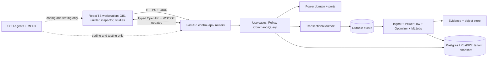

# Backend y frontend — blueprint (arquitectura objetivo)

> **Estado:** diseño objetivo. Hoy la API es `apps/control-api` (FastAPI, solo local) y la UI es `apps/workstation-web/public` (estática). Los paquetes TS y los workers de este plano se crean cuando sus specs lo requieran.

## Decisión de distribución

**Monolito modular primero**: control-api con módulos internos y dominio hexagonal, workers desacoplados para ETL, simulación, optimización, entrenamiento e integración P2P. Separar en microservicios únicamente por evidencias de escala, dominio de seguridad y necesidades de despliegue independientes. MCP nunca se convierte en bus central de producción; MCP es interfaz **de desarrollo/agent-tooling**. La aplicación usa contratos API, events, colas y puertos explícitos.



## Backend: carpetas a desarrollar

```text
apps/control-api/
  src/unitesis_api/
    main.py                   # app factory, routers
    core/{config,errors,security,logging}.py
    middleware/{tenant,trace,rate_limit}.py
    api/v1/{projects,networks,studies,scenarios,jobs,graph,market,auth}.py
    schemas/{requests,responses}.py
    dependencies.py
  tests/{unit,contract,integration}/
packages/python/
  power-domain/              # entidades, invariantes, unidades
  power-ports/               # interfaces explícitas
  power-application/         # comandos/queries y orquestación
  power-adapters/            # repositorios, bus, auth, almacenamiento
workers/                     # no procesos largos dentro de API
```

Especificaciones mínimas de rutas antes de implementar:

| Ruta propuesta | Semántica | Riesgo / control |
|---|---|---|
| `POST /api/v1/networks/import-jobs` | Crear ingesta asíncrona | Formato/mime, tamaño, permisos, licencia, antivirus donde aplique |
| `GET /api/v1/networks/{id}/snapshots/{snapshot}` | Metadata y estado de snapshot | Filtrado tenant y minimización de datos |
| `POST /api/v1/studies` | Job de estudio sobre snapshot | Idempotency-Key, validación y cuota |
| `GET /api/v1/jobs/{job_id}` | Estado/progreso/evidencia | Tenant/owner y paginación |
| `GET /api/v1/graphs/{snapshot}/subgraph` | Projection read-only | Cap de profundidad/nodos y ACL |
| `POST /api/v1/market/simulations` | Mercado P2P simulado | `mode=simulation`, solver AC y autorización |

Estos endpoints son **contratos objetivo** y requieren una spec antes de implementarse.

## Frontend: carpetas a desarrollar

```text
apps/workstation-web/
  src/
    app/{router,providers,layouts}/
    features/
      projects/; networks/; gis/; one-line/; graph-inspector/
      studies/; scenarios/; optimization/; p2p-market/; evidence/; assistant/
    shared/{auth,errors,units,types,accessibility}/
    generated/              # SOLO salida de OpenAPI; no editar a mano
  tests/{unit,component,e2e}/
packages/ts/{api-client,ui-kit,map-engine,one-line-engine}/
```

Decisiones: React + TS strict; router tipado, OpenAPI-generated API client, manejo cache por `tenant_id/network_snapshot_id/study_id`, persistencia limitada de estado UI no sensible; accesibilidad WCAG 2.2 AA como objetivo. MapLibre para GIS, editor de grafo SVG/Canvas/WebGL tras prueba de escala; Web Workers para layouts. El backend es la fuente de verdad para topología/estudios, no los componentes gráficos.

## Tipos/contratos compartidos

Todo dato físico debe incluir `quantity`, `unit`, `reference` cuando aplique (por ejemplo fase/base kV), con distinción V_LL/V_LN, potencia trifásica/per-fase; todas las respuestas de estudio deben incluir snapshot_id, topology_hash, convergencia, versión solver y semilla si hay aleatoriedad. Un contrato no se deriva de estructuras internas del ORM.

## Seguridad API/frontend

- Auth OIDC/OAuth2 con scopes y RBAC/ABAC; session/bff seguro y cookies HttpOnly/SameSite cuando aplique.
- No pasar conexiones directas SQL/GIS desde browser. No usar `localStorage` para tokens de larga vida.
- Defender contra SSRF en importadores, archivos comprimidos maliciosos, query DoS, cross-tenant y prompt injection del copiloto.
- Toda operación destructiva/inversión/aprobación: revisión y confirmación humana, auditoría y firma cuando corresponda.

## Calidad y presupuestos (umbrales definidos por benchmarking posterior)

- API: p50/p95 endpoints read-only, latencia de colas, tasa de error, límites de memoria; no inventar SLO antes de medir infraestructura.
- Frontend: E2E de edición de unifilar reversible, intercambio mapa/unifilar, errores offline/stale, proyectos con cientos/miles de nodos.
- GIS: CRS, terminal/fase, versiones y topología; tests con redes IEEE y muestras autorizadas de VNR.
- Seguridad: al menos una prueba negativa por permiso por tenant y endpoint, además de secretos/CSRF/XSS/SSRF según superficie.
- Datos: índice espacial, control de migraciones y EXPLAIN, sin querys agentes sobre producción.
