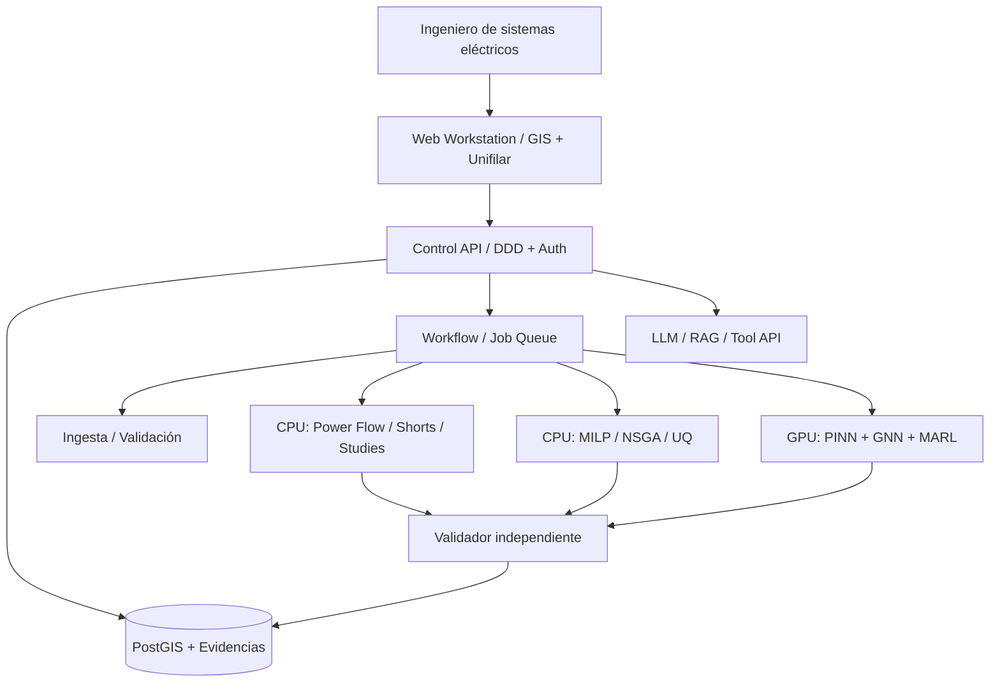

# C4 inicial (contexto + contenedores)

Diagramas C4 de componentes y despliegue se crearán por especificación; no se asume despliegue en Kubernetes sin necesidad.

### V5: Extensiones del diagrama de contenedores

`API -> Graph Query Adapter -> read model (PostgreSQL/NetworkX; Neo4j opcional)`; `API -> P2P Bridge -> trusted peer transport`; `Market Simulation -> Solver AC -> Evidence Store -> optional LedgerAnchor`. GraphRAG consume proyecciones por snapshot y ACL; nunca rutas de SCADA. Ver ADR-0004/0005/0006.
