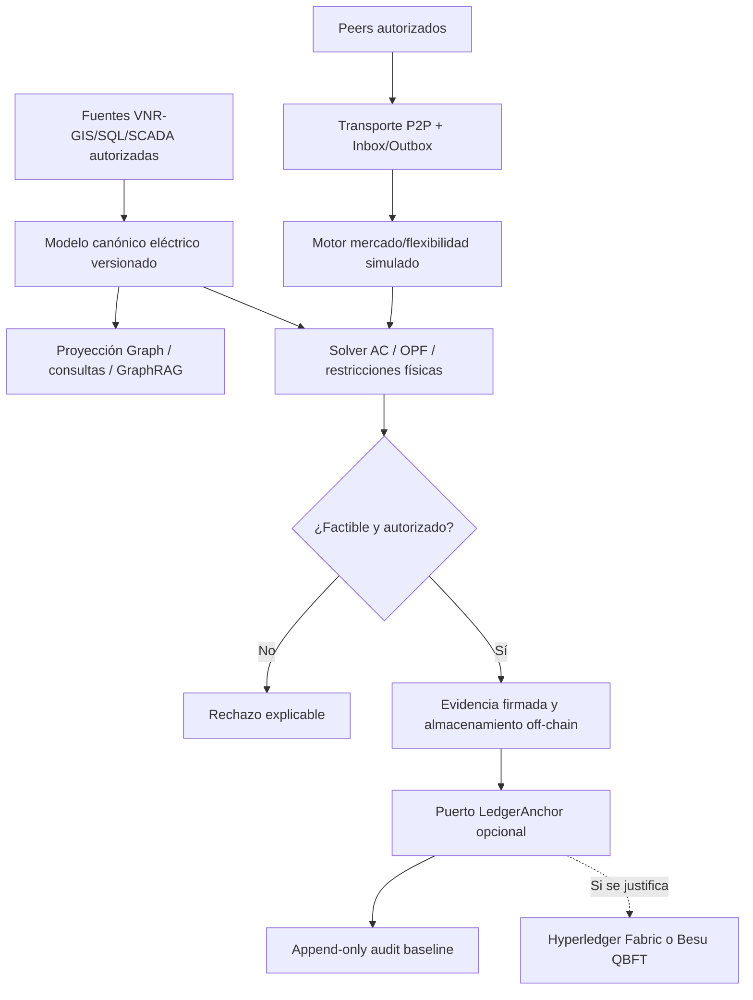

# UNITESIS V5 — Graph + P2P + Blockchain (arquitectura de diseño)

## 1. Semántica separada y fuente de verdad

- **Graph eléctrico:** activos/terminales/fases/interruptores/impedancias y snapshot; es parte de `power-topology` y fuente física autorizada.
- **Graph de activos / conocimiento:** relaciones `Asset -> Feeder -> Substation -> Dataset -> Study -> Evidence -> Standard`; índices de búsqueda y GraphRAG son *read models*, no autoridad.
- **Graph de comunicación P2P:** peers certificados, enlaces seguros, topics y permisos; un enlace P2P no es un conductor.
- **Graph económico:** agentes autorizados, nodos de conexión, ofertas, flexibilidad, asignaciones y mediciones. Referencias a snapshot versionado.

`VNR-GIS/MDB/SQL` → verificación → modelo canónico terminal/fase → snapshot inmutable → cuatro proyecciones distintas. Mantener CRS, relojes, versiones, cambios de maniobra, unidades, fase y consistencia topológica; Neo4j/TigerGraph/JanusGraph opcionales detrás de puertos de repositorio tras evaluación comparativa. MVP: PostgreSQL/PostGIS y NetworkX derivados. Para GraphRAG usar retrieval con filtros de versiones/citas y ACL, jamás modificar el modelo eléctrico.

## 2. Sistemas P2P (dos usos diferentes)

**P2P-Sync:** sincronización distribuida de evidencias y propuestas entre operadoras, edge devices y laboratorios autorizados. Transporte elegido por ADR: servidor/broker o libp2p; conexiones con mTLS o peer keys, allowlist, replay protection, scopes, expiración, firma, hashes, idempotencia, reconexión, límites, colas durables y auditoría. Sin replicación automática de datos confidenciales. Ninguna operación SCADA.

**P2P-Energy/Flex:** submercado de simulación para prosumidores DER, BESS, EV y microredes: subasta bilateral, double auction o ADMM (comparar), costo marginal, costo de pérdidas, congestión, calidad y reparto justo. Separar negociación de reserva de energía física. Un contrato comercial no determina por sí mismo por dónde fluye la potencia eléctrica.

## 3. Flujo seguro off-chain / on-chain

### Exclusiones

- No hay pagos, tokens o mercado real en la V5; no inventar autorización regulatoria peruana.
- No hay operación automática de interruptores, reconectadores, protecciones o SCADA.
- Blockchain no valida leyes de Kirchhoff, ni garantiza verdad de los sensores: requiere oráculo/medición confiable.
- PINN, GNN, LLM y MARL no certifican resultados de power flow.

## 4. Modelo matemático mínimo (investigación)

Maximizar bienestar social neto de pérdidas y congestión:

\[
\max_{q,p,V,\theta}\left[\sum_{b,t}U_{b,t}(q_{b,t})-\sum_{s,t}C_{s,t}(q_{s,t})
-\sum_t C_{loss,t}-\sum_t C_{grid,t}\right]
\]

Sujetos a balance nodal AC \(P_i=\operatorname{Re}(V_i \overline{\sum_jY_{ij}V_j})\),
\(Q_i=\operatorname{Im}(V_i \overline{\sum_jY_{ij}V_j})\), límites térmicos,
de tensión según ámbito normativo/tensión, transformadores, seguridad, restricciones
BESS SOC/eficiencia y flexibilidad EV. La oferta P2P no elimina las restricciones
eléctricas de la red. Establecer función multiobjetivo: bienestar, pérdidas,
congestión, equidad, confiabilidad y costo transaccional. Validar distribución de
costes y factibilidad de acuerdos contra el solver y mediciones.

## 5. Modelo de seguridad y gobernanza

Amenazas: Sybil/eclipsing, spoofing, mensaje duplicado/replay, split-brain, exfiltración,
falsificación de medidores/oráculos, compromisos de peer, contrato defectuoso,
reorganización/indisponibilidad de validators, filtración de metadatos, combinación
inter-tenant y data poisoning de GraphRAG. Controles: PKI + mTLS, rotación de
claves, KMS/HSM, RBAC/ABAC, cifrado, privacidad por defecto, registro auditor,
separación de duties, firma e integridad de evidencia, tests de ataques.

**Ledger no es necesario** cuando todos los nodos pertenecen a una sola
organización bajo auditoría central; comparar una bitácora firmada append-only
antes de aceptar el coste de Fabric/Besu.

## 6. Decisión de despliegue

Fase A: simular P2P-energy offline con datos sintéticos + grafos + solver. Fase B:
P2P-sync aislado sin comercio. Fase C: comparar auditoría central firmada vs Fabric
vs Besu en laboratorio 4 nodos. Fase D: interoperabilidad, compliance y piloto
regulado **solo** cuando haya aprobaciones expresas y caso económico positivo.

Regulación peruana: la RM 439-2024-MINEM/DM publicada en noviembre 2024 trató
un *proyecto* de reglamento de generación distribuida; la consulta 2025 no
significa por sí sola permiso de comercio P2P de usuarios regulados. La ejecución
comercial requiere dictamen jurídico actualizado específico para cada modalidad.

## 7. Fuentes externas verificadas (revisión 2026-10-17)

- GitHub Spec Kit: https://github.com/github/spec-kit/blob/main/docs/concepts/sdd.md
- libp2p, conceptos y seguridad: https://libp2p.io/docs/ ; https://libp2p.io/docs/security-considerations/
- Hyperledger Fabric, private data: https://hyperledger-fabric.readthedocs.io/en/release-2.5/private-data-arch.html
- Besu QBFT: https://docs.besu-eth.org/private-networks
- NIST, *Applying Retail Markets and Transactive Resources for Grid Flexibility* (2026): https://www.nist.gov/publications/applying-retail-markets-and-transactive-resources-grid-flexibility
- NIST Transactive Market Co-Simulation (2026): https://www.nist.gov/publications/nist-transactive-energy-market-federate-te-market-gridlab-d-co-simulations
- Ping et al., *Applied Energy* 405 (2026), DOI: https://doi.org/10.1016/j.apenergy.2025.127195
- IEC CIM (perfil/versión a acordar): https://cim.fein-aachen.org/libcimpp/doc/IEC61970_17v23/classIEC61970_1_1Base_1_1Topology_1_1TopologicalNode.html
- Graph Data Science: https://neo4j.com/docs/graph-data-science/current/introduction/
- PyTorch Geometric Temporal: https://pytorch-geometric-temporal.readthedocs.io/en/latest/
- MINEM prepublicación: https://www.gob.pe/institucion/minem/normas-legales/6223160-439-2024-minem-dm
- MINEM comentarios 2025: https://www.gob.pe/institucion/minem/informes-publicaciones/7195335-informe-y-matriz-de-comentarios-del-resultado-de-la-consulta-publica-regulatoria
- Osinergmin usuarios libres: https://prie.osinergmin.gob.pe/PF-SICLI
