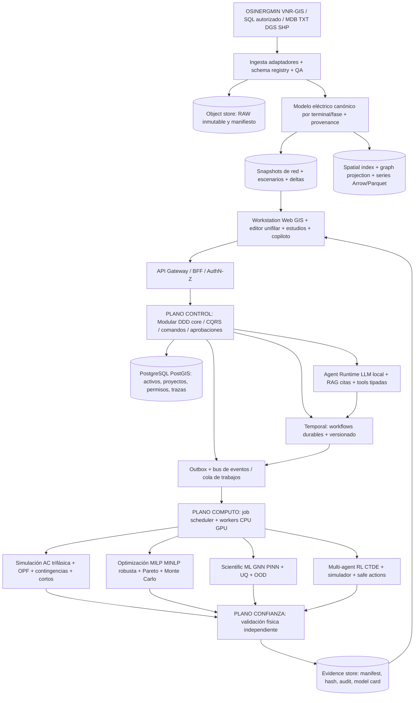

# UNITESIS POWER INTELLIGENCE — Arquitectura avanzada V3.0

**Fecha:** 16 octubre 2026. **Estatus:** arquitectura objetivo de grado industrial + agenda científica verificable, no software en producción. **Trazabilidad:** integra `Conceptos clave de IA.md`, `LLM Local en Python.md`, `PROYECTO_MAESTRO_IA_PLANIFICACION_ELECTRICA.md`, y arquitectura V2. **Objetivo:** plataforma de ingeniería de potencia y gemelo digital geoespacial, con IA científica transparente, análisis de red y planificación robusta de generación, transmisión, distribución, DER, EV y BESS. Comparable en cobertura aspiracional —NO equivalencia demostrada— a herramientas profesionales.

## 0. Dictamen de arquitectura y decisiones no negociables

1. **El estado de verdad no es el LLM ni la PINN:** lo forman el modelo de red, las mediciones con procedencia, los parámetros y las soluciones verificadas por motores físicos de referencia.
2. **Cuatro planos independientes**: control/colaboración, datos/gemelo, cómputo científico, confianza/seguridad. Separación entre ruta de lectura y comandos; escenarios inmutables, resultados vinculados a hash.
3. **Tres representaciones sincronizadas**: inventario GIS original, grafo eléctrico por terminales/conductores y representación visual de unifilar. Su geometría no es intercambiable; el esquema unifilar no modifica distancias eléctricas.
4. **Despliegue gradual**: monolito modular de dominio en control; workers distribuidos independientes; extracción a servicios solo por evidencia de carga/aislamiento/licencias.
5. **IA híbrida y jerárquica**: LLM para tareas semánticas y herramientas tipadas, GNN/Graph-PINN como aproximador, MARL/CTDE para políticas experimentales, MILP/MINLP/NSGA-III para decisiones, simulador y guardrails para aceptación.
6. **Ingeniería sin caja negra de negocio**: clases, tensores, arquitectura neuronal, ecuaciones, pérdidas, políticas, seeds, hiperparámetros, modelos y decisiones auditables. Usar bibliotecas externas no equivale a aceptar modelos opacos: aislar con interfaces y tests.
7. **Aprobar cambios reales siempre mediante workflow autorizado**: agentes proponen ramas de estudio; no operan protecciones, interruptores o sistemas SCADA de producción.

## 1. Arquitectura de referencia: cuatro planos, doce subsistemas



**Subsistemas:** (01) identidad/gobierno; (02) catálogo de fuentes; (03) registro de equipos/topologías; (04) telemetría y pronóstico; (05) red canónica; (06) motor de casos/escenarios; (07) simulación determinista; (08) optimización con incertidumbre; (09) SciML y políticas; (10) agentes LLM/RAG; (11) visualizador profesional; (12) auditoría, validación y reporting. Su independencia debe probarse con pruebas de contrato.

### 1.1 Diseño de ejecución: control vs trabajo pesado

- El API controla autorizaciones y comandos cortos; **nunca** aloja entrenamientos ni simulaciones costosas en el request HTTP.
- Workflows de larga vida con reintentos idempotentes, checkpoint, compensación, cancelación, tiempos límite y cuotas por organización. Temporal documenta recuperación durable tras fallas; no garantiza por sí solo exactitud eléctrica.
- Workers CPU para ETL, OpenDSS y escenarios; GPU para GNN/PINN/LLM local; workers optimización para Pyomo/HiGHS o solver licenciado. Pools y recursos separados para evitar que una simulación 8760/35040 puntos congele la UI.
- Se usará **modelo de ejecución reproducible**: `run_id`, `snapshot_sha256`, `scenario_sha256`, `config_sha256`, `code_commit`, `solver_name/version`, `units`, `reference_case`, `seed`, `start/end`, `environment_lockfile`, `input_hashes`.
- Comunicación: REST/OpenAPI para CRUD y comandos; WebSocket o SSE para progreso; eventos mediante outbox transaccional; Arrow/Parquet/Protobuf para volúmenes masivos. No introducir Kafka sin volumen que lo justifique.

### 1.2 DDD y contratos de arquitectura

**Bounded contexts**: SourceAcquisition; AssetRegistry; ElectricalTopology; SpatialModel; Measurements; StudyCase; ScenarioPlanning; PowerFlow; ShortCircuit; Reliability; Optimization; MachineLearning; AgentOrchestration; RegulatoryKnowledge; Reporting; TenantSecurity. Cada uno tiene agregados, invariantes, repositorios y contratos explícitos.

**Invariantes**: 1) ningún equipo sin ID estable; 2) terminal/fase/tensión compatibilizados antes de componer nodos; 3) geometría no redefine impedancias; 4) escenarios no sobrescriben snapshot; 5) parámetros faltantes no se imputan silenciosamente; 6) toda alternativa recomendada incluye prueba física y costo trazable; 7) toda acción agente queda en bitácora.

**Eventos de dominio**: `SourceIngested`, `SchemaMapped`, `TopologyValidated`, `NetworkSnapshotPublished`, `ScenarioBranched`, `LoadAdded`, `StudyRequested`, `StudyCompleted`, `StudyRejected`, `ModelTrained`, `OptimizationCandidateValidated`, `ReportApproved`. Cada evento con `event_id`, `aggregate_id`, `event_version`, `causation_id`, `correlation_id`, `actor_id`, timestamp UTC y hash de payload.

## 2. Gemelo digital bitemporal, geoespacial y eléctrico

### 2.1 Capa Bronze / Silver / Gold / Scientific

- **Bronze/RAW:** copias exactas de VNR-GIS, MDB, TXT, SQL dumps, SHP, GeoPackage, CSV, DGS, perfiles e inventarios, con licencia/origen, SHA-256, timestamp y retención. No afirmar que un VNR-GIS contiene potencias/curvas ni datos operativos que no posee.
- **Silver:** tabla a formato canónico, normalización de unidades, CRS y tipos, deduplicación con reglas configurables, conectividad preliminar, catálogo de faltantes y cuarentena.
- **Gold:** equipos y conexiones validables; grafo operativo por fases; series calibradas; catálogos de conductores/equipos; parámetros aprobados; matrices Ybus por snapshot.
- **Scientific:** tensores, batches de grafos, datasets train/val/test por fecha/red/empresa, simulaciones etiquetadas solo cuando existan, covariables/escenarios synthetic, no fuga entre entrenamiento y prueba.

### 2.2 Modelo CIM-aligned, no falso cumplimiento IEC

Se diseñará un **canonical schema inspirado** en IEC 61968/61970 CIM; declarar conformidad a una edición/perfil CGMES solo tras probar intercambio y conformance. Entidades mínimas: `Company`, `Network`, `Substation`, `Feeder`, `Equipment`, `ConductingEquipment`, `Terminal`, `ConnectivityNode`, `TopologicalNode`, `BaseVoltage`, `ACLineSegment`, `PowerTransformer`, `TransformerEnd`, `Switch`, `Fuse`, `Recloser`, `EnergyConsumer`, `PowerElectronicsConnection`, `DER`, `Storage`, `EVCharger`, `Measurement`, `Curve`, `SwitchState`, `Scenario`, `StudyRun`. Cada atributo con `source`, `unit`, `quality`, `valid_time`, `transaction_time` y `assumption_status`.

**Bitemporalidad:** separar `valid_from/valid_to` del activo real de `recorded_at/superseded_at` del conocimiento del sistema; usar snapshot hash y deltas (event sourcing selectivo, no forzado para todos los datos). Permite reconstruir cuál red se conocía y cuál se suponía en la fecha del estudio.

### 2.3 Reconstrucción topológica y prueba matemática

Convertir capas GIS a `multigraph` direccionado opcionalmente; los vértices de conectividad reflejan terminales, fases, barras, switches y transformadores; no unir automáticamente líneas por proximidad espacial. Validar nodos aislados, bucles, multiaristas, empalmes incompatibles, fase faltante, cambio de tensión, switch abierto, circuitos en paralelo, nodos virtuales y extremos sin fuente. Cambios correctivos requieren anotación y aprobación. Calcular red energizada desde subestaciones bajo estado de maniobras.

**Triple visualización vinculada por UUID:** (a) cartografía métrica CRS+GIS; (b) unifilar eléctrico esquemático auto-layout pero editable; (c) árbol de activos y tabla de propiedades. Undo/redo mediante comandos; diferenciar operación de representación (mover icono) de cambio eléctrico (mover nodo, crear tramo, cambiar switch).

## 3. Núcleo numérico y jerarquía de precisión

### 3.1 Familia de motores, no un único solver

| Estudio | Referencia propuesta | Contrato de aceptación |
|---|---|---|
| Flujo AC de distribución desequilibrado | DSS-Extensions/OpenDSS; alternativa OpenDSS EPRI | P/Q nodales, pérdidas, fases, convergencia, tensiones por fase |
| Flujo AC balanceado, estimación y fallas cuando aplicable | pandapower | comparación en caso compatible, método/versionado |
| Expansión y despacho G-T | PyPSA / Pyomo + optimizadores compatibles | energía no suministrada, congestión, CAPEX/OPEX, restricciones |
| Cortocircuito IEC/ANSI | motor con cobertura normativa comprobada por caso | tipo de falla, corriente inicial, supuestos, base de cálculos |
| Dinámica RMS / EMT / protecciones / armónicos | **módulos especializados futuros** o integración licenciada | no publicitar capacidad no implementada |
| Riesgo y confiabilidad | Monte Carlo de contingencias, ENS, índices por regla | convergencia estadística y trazabilidad de distribución |

Conectar simuladores mediante puertos `LoadFlowEngine`, `FaultEngine`, `TimeSeriesEngine`, `ExpansionEngine`, `DynamicsEngine`; plugins adaptadores y registro de capacidades (no sustituciones silenciosas). Para escenarios de 15 minutos hay 35 040 intervalos en año no bisiesto, no 8760.

### 3.2 Ecuaciones de referencia AC

Para todas las fases representadas en forma compleja:

\[I=Y_{bus} V;\quad S_i^{calc}=V_i\overline{(Y_{bus}V)_i}\]

\[r_i^P=P_i^{inj}-\Re(S_i^{calc}),\qquad r_i^Q=Q_i^{inj}-\Im(S_i^{calc})\]

Elementos de transformación, neutro, reguladores, cargas ZIP, DER e inversores requieren modelos de elemento particulares. KCL y balance no se sustituyen por suma escalar de demanda/generación. La longitud geográfica pasa a longitud eléctrica solo tras resolver rutas, proyección y reglas de tramos.

### 3.3 Motor de validación independiente

Tres pasadas: (A) sintáctica/topológica, (B) física/térmica/normativa con tolerancias configuradas por estudio y cláusula, (C) independencia de solver en subcasos compatibles. Prueba de conservación P,Q, impedancias, pérdidas, unidades, base MVA, tap y control de voltaje, límites de funcionamiento. Estados: `PASS`, `WARNING`, `FAIL`, `INDETERMINATE` (falta información). Un `WARNING` no puede convertirse en aprobación automática.

## 4. Inteligencia artificial avanzada propia

### 4.1 Plataforma SciML transparente basada en grafos

Arquitectura aspiracional `Heterogeneous Temporal Physics-GNN + Neural Operator + Uncertainty head`:

1. **Encoder heterogéneo** de buses, terminals, branches, switches, transformadores, DER, EV, BESS, estado de maniobra; atributos numéricos y metadatos de calidad.
2. **Message-passing phase-aware** 3 a 8 bloques como hipótesis inicial a optimizar, no límite universal; topología heterogénea y transformaciones por fase.
3. **Encoder temporal** TCN/Transformer ligero para 15 minutos/intervalos multiescala y variables exógenas; atención a masks por faltantes.
4. **Física diferenciable:** capa Ybus/vectores complejos, restricciones de frontera, pérdidas KCL/AC, márgenes térmicos, conservación y penalizaciones escaladas; considerar proyección factible como postprocesado.
5. **Heads multi-tarea:** tensiones |V|, ángulos, I por fase, pérdidas, cargabilidad, contingencia/riesgo, intervalos de predicción, detección OOD.
6. **Gating de precisión:** ante OOD, baja confianza o cambios de topología significativos, derivar a solver físico; no usar PINN como certificación.

**Baselines exigidos:** solver completo; linearizaciones DC/DistFlow cuando corresponda; MLP, XGBoost, GNN sin física, PINN sin grafos; evaluación en red no vista, perturbación de switching, nuevas cargas y renovables. No proclamar `100x`, `cero violaciones` ni `sub-ms` sin benchmarks.

### 4.2 Entrenamiento y distilación responsables

El dataset principal de **topología/activos** procede de VNR-GIS/GIS, no de un dataset PowerFactory supuesto. Entrenar usando (i) invariantes físicos, (ii) escenarios sintéticos parametrizados, (iii) observaciones autorizadas, y (iv) referencias de motores compatibles cuando estén disponibles. Split temporal y por feeder/empresa para medir generalización; no mezclar escenarios de red clonada entre train y test.

`L_total = λdata Ldata + λP ||rP||² + λQ ||rQ||² + λV LV + λI LI + λBC LBC + λU LU`. Pesos adaptativos (GradNorm/NTK-style como experimentos), grad clipping, constraints por familias de equipos, logs por término. Optimización AdamW + refinamiento L-BFGS solo si benchmark lo justifica; validación con error máximo por nodo/fase y calibración UQ.

Destilación: profesor = herramientas verificadas + ejemplos con explicaciones **externas auditables** (decisiones, ecuaciones, invocaciones y resultados), no pretender capturar razonamiento interno confidencial de un modelo. Alumno = política estructurada pequeña con test suite. Se debe comprobar licencia de modelos/datos.

### 4.3 MARL jerárquico y seguro

- **Nivel estratégico**: horizonte multianual, inversión irreversible, ubicación SED/BESS/DER, reconductorizar, nuevos feeders y resiliencia.
- **Nivel táctico**: asignación de inversiones, transferencia de carga, selección de mantenimiento, redespacho de escenarios.
- **Nivel operativo de simulación**: switching permitido, setpoints DER/BESS y control Volt/VAR dentro de entorno ficticio/estudio.
- **Actores** por alimentador, SED, DER, almacenamiento; **crítico centralizado CTDE** con GNN, máscaras de acciones y detector de violación, recompensa normalizada.
- Recompensa múltiple sobre ENS, CAPEX anualizado, OPEX, pérdidas, VDI, SAIDI/SAIFI cuando se puedan estimar, emisiones, resiliencia; separar restricciones duras de tradeoffs.
- Comparar MAPPO/QMIX/MADDPG según espacio de acciones, contra MILP/MINLP, NSGA-II/III y greedy; sin afirmar que MARL siempre mejora los óptimos.

### 4.4 LLM local + herramientas verificadas

El copiloto no ejecuta código arbitrario de las respuestas; convierte peticiones en `StudySpecification` JSON validado, obtiene datos por RAG documental versionado y herramientas con permisos (ej. `create_scenario`, `add_proposed_load`, `run_power_flow`, `optimize_bess`, `compare_scenarios`, `generate_report`). Herramientas con esquemas estrictos, límites, dry-run, HITL y bitácora. Separar planificador semántico de motores de cálculo y crítico científico.

Agentes: investigador de normativa (fuentes y edición), ingestión/cartografía (solo propuesta de mapping), modelador (calidad de datos), eléctrico (coordina solver), optimizador, riesgo/UQ, revisor independiente y redactor. El LLM puede equivocarse: todas las afirmaciones numéricas importantes deben apuntar a evidence_id/resultados de simulación.

## 5. Optimización multiobjetivo, estocástica, robusta y espacial

Funciones: minimizar `NPV(CAPEX + OPEX_perdidas + ENS + riesgo + mantenimiento)`, impactos medioambientales y demora en entrada comercial; maximizar resiliencia/capacidad de hospedaje y robustez; construir frente de Pareto y comparar soluciones no dominadas. Decisiones discretas (conductor, ubicación, feeder, switch) y continuas (potencias/taps/dispatch); horizonte multiperíodo 5–20 años con variables de construcción y disponibilidad.

- Restricciones eléctricas duras: flujo AC, ampacidad dependiente de condiciones, tensión normativa según nivel y caso, límites térmicos/taps, radiales o mallados según estudio, cortocircuito/protecciones aplicables, contingencias N-1 donde requerido.
- Restricciones geográficas: servidumbre, zonas protegidas, pendientes, seguridad, longitud/costo de trazado y permisos. Lo georreferenciado informa costo, no determina automáticamente viabilidad legal.
- Escenarios externos: crecimiento, actividad agroindustrial/minera, clima, EV, DER, carga emergente >200 kW, tarifas/precios, retrasos y tiempos de compra; correlaciones y tendencia no se suponen sin datos.
- Métodos: Benders/column generation cuando separabilidad demostrada; SAA/Monte Carlo/LHS; CVaR; chance constraints; NSGA-III/pymoo; ajuste de heurísticas mediante aprendizaje solo si aporta.
- Salida: `ParetoFront` con inversión, pérdidas, ENS, riesgo, márgenes físicos, ubicación GIS y evidencia de cada solución.

## 6. Experiencia de usuario de nivel software de ingeniería

**Workstation Web profesional** (React/TypeScript, WebGL/MapLibre + canvas/GPU para gran escala; React Flow solo para casos pequeños o prototipo):

- Cuatro paneles redimensionables: explorador de proyectos, mapa GIS, unifilar, propiedades/capas/estudios. Multi-monitor, búsquedas, breadcrumbs, selección sincronizada por UUID, hover con datos físicos.
- Editor bidireccional con snapping de **conectividad eléctrica**, símbolo IEC, barra, alimentador, SED, transformador de varios devanados, breaker, load, DER, BESS, regulador; herramientas de rutas y perfiles; diff de escenarios y before/after.
- Modo planeamiento interactivo: insertar carga de 200 kW a múltiples MW, trazar feeders, ubicar SED/DER/BESS, cambios de conductor, alternativas de transferencia; ejecutar lotes con barra de progreso y cancellation.
- Heatmaps de voltaje/cargabilidad/pérdidas, animación temporal (15-min), bandas de confianza y Pareto 2D/3D; provenance al seleccionar resultado.
- Exportadores: GeoPackage, GeoJSON, tablas, PDF técnico, trazas CSV/Parquet, DGS mediante adaptador validado; no prometer round-trip completo sin tests de fidelidad.
- Accesibilidad y navegación teclado; modo trabajo offline planificado si hay necesidad, no garantizado por interfaz web sola.

## 7. Infraestructura SRE, privacidad, supply chain y observabilidad

**Ambientes** dev/test/staging/prod; Linux containers para servicios, ejecución Windows cuando software/driver GIS o PowerFactory necesiten Windows y licencias. IaC declarativa; OpenTelemetry logs/métricas/traces, Prometheus/Grafana, Sentry opcional; SBOM, SLSA/provenance, firma de artefactos, escaneo SAST/DAST, secret manager, copias 3-2-1 y DR probado. RBAC/ABAC multi-tenant, filas aisladas (RLS donde viable), cifrado tránsito/reposo, mínima exposición de datos empresariales; LLM local para información restringida.

**SLO candidatos a validar**, no garantías: API p95 < 500 ms para lecturas con índice (sin simulación); UI primera renderización < 3 s en escenario controlado; flujos de eventos actualizados cada 1–5 s; recuperación tras reinicio de worker sin perder progreso confirmado; tasa de importación sin corrupción 100% sobre fixtures; resultados numéricos bajo tolerancias por benchmark. Benchmark por número de equipos 1k/10k/100k, intervalos 96/8760/35040, redes radial/mallada, Windows/Linux.

**Gobernanza**: NIST AI RMF, OWASP para amenazas de LLM, ISO/IEC 25010 y estándares eléctricos pertinentes; ISO/IEC/IEEE específicos solo tras identificar cláusulas aplicables y licencias. Validar derechos del VNR-GIS y registros de empresas antes de distribuir datasets.

## 8. Monorepo y módulos implementables

```text
unit esis-power-intelligence/              # nombre de carpeta sin espacio: unitesis-power-intelligence
  README.md
  ARCHITECTURE.md
  docs/{adr,c4,arc42,contracts,standards,benchmark,traceability,research}
  apps/{web-workstation,api-control,worker-console}
  packages/{ui,design-system,sdk-types,api-contracts,schemas,units,provenance}
  domain/{assets,topology,scenarios,studies,optimization,measurements,governance}
  adapters/{vnrgis,mdb,txt,sql,shp,dgs,cim,opendss,pandapower,pypsa}
  compute/{topology-engine,simulation-engine,solver-registry,optimizer,uncertainty}
  ai/{datasets,physics-gnn,pinn,neural-operator,marl,llm-runtime,rag,agent-tools,evaluation}
  orchestration/{workflows,events,outbox,job-scheduler}
  storage/{postgres,migrations,objects,parquet,indexes}
  frontend/{map-canvas,one-line-canvas,study-explorer,comparison,pareto,reporting}
  infra/{containers,k8s-optional,terraform-optional,observability,security}
  tests/{unit,contract,integration,e2e,property,metamorphic,benchmarks,security,golden}
  fixtures/{ieee-feeders,synthetic-vnrgis,licensed-real-samples}
  scripts/{bootstrap,doctor,load-fixtures,migrate,benchmark,validate-model}
  pyproject.toml
  uv.lock
  package.json
  pnpm-lock.yaml
  .github/workflows/{ci.yml,security.yml,benchmark.yml}
```

**Nota:** no meter 50 bibliotecas en `requirements.txt` sin comprobar usos y conflictos: usar `pyproject.toml` por grupos con lock, soporte Python elegido luego de matriz OS/GPU/solvers; frontend `pnpm-lock.yaml`; reproducibilidad mediante hashes de contenedores y pesos, no solo versión nominal. En Python el código propio será modular y documentado, no copiar ejemplos seudofuncionales de las conversaciones como si ya pasaran pruebas.

## 9. Roadmap de ingeniería con puertas medibles

| Puerta | Entregable executable | Condición mínima de salida |
|---|---|---|
| G0 Fundamentos | ADR + amenazas + modelo CIM-aligned + repo CI | contratos publicados, unit tests, licensing review |
| G1 Ingesta universal | adaptadores, data-quality report, bronze/silver | fixture de tres tipos, evidencia y cuarentena; sin supuestos ocultos |
| G2 Gemelo y UI | PostGIS/grafo + GIS/unifilar vinculados | UUID estable, ciclos de edición/undo/redo y baseline repro |
| G3 Flujo eléctrico | import->motor->validación->informe | IEEE test feeder y casos reales autorizados; P/Q/V/I dentro de tolerancias |
| G4 Estudios eléctricos | nueva carga, transf. feeder, N-1, escenarios temporales | resultado antes/después auditable y sin mutar snapshot |
| G5 Optimización | ubicación SED/BESS, conductor, feeder, Pareto | candidatos factibles validados por solver, gaps y robustez |
| G6 Scientific ML | GNN/PINN, MLflow, UQ/OOD | superar o documentar no superación de baselines en splits inéditos |
| G7 MARL/LLM | simulador agente, action masks, herramientas tipadas | cero ejecución no autorizada; evaluación contra políticas clásicas |
| G8 Escala comercial | observabilidad, tenancy, DR, despliegue | load test, pentest, disaster recovery y licencias aprobadas |

**Primer vertical slice obligatorio:** Importar alimentador VNR-GIS validado → grafo trifásico → map+unifilar → añadir carga emergente → flujo con OpenDSS → indicador V, I, pérdidas, margen de feeder → comparar antes/después → informe reproducible. Si los atributos eléctricos no existen, bloquear simulación y generar inventario de faltantes, nunca inventarlos.

## 10. Matriz de investigación internacional y palabras clave

La V2 contiene 88 entradas **identificadas**, no 88 papers íntegramente verificados. Se conserva abajo ese catálogo con sus estados originales. En V3 la revisión doctoral debe extraer por registro: DOI/ISBN/URI, título original, autores, año, universidad/editorial, tesis o artículo, idioma, peer-review/indexación, acceso abierto, problema, arquitectura, formulación, dataset, solvers, métricas, licencias, limitaciones y grado de evidencias. No contabilizar repositorios o documentación como artículos indexados.

| Línea | Palabras clave EN / ES / DE / FR / PT | Evidencia requerida |
|---|---|---|
| Arquitectura | domain-driven design, hexagonal architecture, event-driven simulation, software architecture for digital twins / arquitectura hexagonal / Softwarearchitektur / architecture logicielle / arquitetura de software | contratos, replicación, latencias, modelos de falla |
| Ingeniería de redes | phase-domain power flow, three-phase unbalanced OPF / flujos trifásicos desequilibrados / dreiphasiger Lastfluss / écoulement de puissance déséquilibré / fluxo de potência trifásico | ecuaciones, pruebas en feeders, precisión |
| GIS / CIM | VNR-GIS, CIM interoperability, topology processing / topología GIS / Stromnetz Netztopologie / topologie géographique / topologia de redes | formatos, esquema, unidades, calidad |
| Graph SciML | physics-informed graph neural network power flow / redes neuronales en grafos física / physikinformierte GNN / réseaux de neurones à graphes / redes neurais em grafos | generalización OOD, residual físico |
| Temporal / BESS / EV | temporal graph transformer DER EV BESS / vehículo eléctrico y baterías / Elektrofahrzeuge Speicher / véhicules électriques stockage / veículos elétricos baterias | incertidumbre, explotación temporal |
| MARL | safe multiagent reinforcement learning grid restoration, MAPPO / aprendizaje multiagente seguro / sicheres Mehragentenlernen / apprentissage multi-agent sûr / aprendizagem multiagente segura | línea base, políticas, violaciones |
| Optimización | stochastic multistage distribution expansion, CVaR, NSGA-III / expansión estocástica / stochastische Netzplanung / planification stochastique / planejamento estocástico | convergencia, gap, Pareto, robustez |
| Local LLM agents | tool-using LLM agents engineering, grounded RAG / agentes IA auditables / überprüfbare KI-Agenten / agents vérifiables / agentes auditáveis | citas, seguridad, reproducibilidad |

**Fuentes primarias de implementación confirmadas recientemente:** Temporal (durable workflows); DSS-Extensions (OpenDSSDirect.py, Windows/Linux/macOS); MLflow (linaje y versionado); GridAPPS-D (plataforma abierta de apps de distribución). Son documentación/herramientas, no resultados científicos arbitrariamente extrapolables. Referencias oficiales:

- https://docs.temporal.io/temporal
- https://dss-extensions.org/OpenDSSDirect.py/
- https://www.mlflow.org/docs/latest/model-registry/
- https://github.com/GRIDAPPSD/GOSS-GridAPPS-D

## 11. Riesgos intelectuales y comerciales que invalidan una mala propuesta

- Los archivos VNR-GIS **no son etiquetas de flujos** y requieren parámetros de equipos, modelos de fuente y perfiles.
- Una PINN con restricciones blandas no garantiza factibilidad exacta ni rapidez universal. Neuroevolución no asegura encontrar la mejor arquitectura global.
- Un LLM no es sustituto de ingeniería normativa ni de solver; ingeniería inversa debe respetar licencias y secreto empresarial.
- MARL y LLM multiagente no son sinónimos: el primero aprende políticas por recompensas; el segundo coordina decisiones simbólicas; pueden complementarse.
- No prometer replicar DIgSILENT PowerFactory en toda su cobertura (estabilidad, EMT, protecciones) sin motores y bancos de ensayo correspondientes.
- "EUPHEMIA" posiblemente se refiere al algoritmo de acoplamiento de mercados eléctricos europeos; exigir definición funcional antes de añadirlo al alcance como solver de red.
- Normas peruanas de tensión, calidad y concesiones deberán indexarse por edición y ámbito; no fijar por defecto ±5% para todos los estudios.
- La bibliografía heredada mezcla fuentes localizadas y entradas institucionales candidatas; no confundir alcance bibliográfico con revisión sistemática certificada.

## 12. Decisiones técnicas recomendadas (ADR iniciales)

| ADR | Decisión | Justificación |
|---|---|---|
| ADR-001 | Modular core + workers distribuidos | cohesión de negocio, escalabilidad específica y control de complejidad |
| ADR-002 | Postgres/PostGIS + object store + Parquet | geometría relacional, crudos inmutables y análisis columnar |
| ADR-003 | CIM-aligned canonical, sin declarar certificación | interoperabilidad gradual y semántica explícita |
| ADR-004 | Snapshot inmutable con deltas y provenance | reproducibilidad de estudios |
| ADR-005 | OpenDSS primero distribución, adapters neutros | validación física rápida sin dependencia única |
| ADR-006 | Web GIS + unifilar de renderizado especializado | escalabilidad de visualización y UX de ingeniería |
| ADR-007 | ML asistente, no fuente de verdad | evitar decisiones físicamente inválidas |
| ADR-008 | GNN/PINN híbrida con OOD fallback | geometría/topología variable y control de error |
| ADR-009 | MARL solo simulación con safety shield | aislamiento operacional |
| ADR-010 | Workflows durables, no tareas HTTP | resiliencia de jobs extendidos |
| ADR-011 | Registro de modelos/datasets y evidencias | reproducibilidad y auditoría |
| ADR-012 | Quarantine y no-imputación silenciosa | integridad técnico-regulatoria |

---

## Anexo A — Bibliografía original de V2 (mantiene clasificación y límites de verificación)

## 6. Registro bibliográfico inicial (fuentes identificables)

**Interpretación del estado:** las fuentes **localizadas en búsqueda web** tienen resultado identificable encontrado durante esta sesión; no significa que cada PDF fue leído íntegramente ni que la calidad científica fue evaluada. Las fuentes **candidatas** corresponden a portales/documentación técnica conocidos, por confirmar versión y compatibilidad. El listado mezcla deliberadamente artículos, tesis, libros, normas y aplicativos, que no deben confundirse como  publicaciones científicas arbitradas.

1. **[Software; EN; Localizado en búsqueda web]** [Fundamentals of Software Architecture, 2nd ed. (Richards & Ford, 2025)](https://www.oreilly.com/library/view/fundamentals-of-software/9781098175504/). Aplicación: evidencia de arquitectura, matemática, investigación o implementación según categoría.
2. **[Software; EN; Localizado en búsqueda web]** [Software Architecture: The Hard Parts (Ford et al., 2021)](https://www.oreilly.com/library/view/software-architecture-the/9781492086888/). Aplicación: evidencia de arquitectura, matemática, investigación o implementación según categoría.
3. **[Software; EN; Localizado en búsqueda web]** [Building Evolutionary Architectures, 2nd ed. (Ford et al., 2022)](https://www.oreilly.com/library/view/building-evolutionary-architectures/9781492097532/). Aplicación: evidencia de arquitectura, matemática, investigación o implementación según categoría.
4. **[Software; EN; Localizado en búsqueda web]** [Microservices Guide — Martin Fowler](https://www.martinfowler.com/microservices/). Aplicación: evidencia de arquitectura, matemática, investigación o implementación según categoría.
5. **[Software; EN; Localizado en búsqueda web]** [arc42 Method](https://arc42.org/method/). Aplicación: evidencia de arquitectura, matemática, investigación o implementación según categoría.
6. **[Software; EN; Localizado en búsqueda web]** [arc42 Quality Requirements](https://docs.arc42.org/section-10/). Aplicación: evidencia de arquitectura, matemática, investigación o implementación según categoría.
7. **[Software; EN; Localizado en búsqueda web]** [AWS Well-Architected: six pillars](https://docs.aws.amazon.com/wellarchitected/latest/framework/the-pillars-of-the-framework.html). Aplicación: evidencia de arquitectura, matemática, investigación o implementación según categoría.
8. **[Software; EN; Localizado en búsqueda web]** [AWS Well-Architected definitions](https://docs.aws.amazon.com/wellarchitected/latest/framework/definitions.html). Aplicación: evidencia de arquitectura, matemática, investigación o implementación según categoría.
9. **[Software; EN; Localizado en búsqueda web]** [arc42 twelve sections](https://examples.arc42.org/sections/). Aplicación: evidencia de arquitectura, matemática, investigación o implementación según categoría.
10. **[Norma; EN; Localizado en búsqueda web]** [ENTSO-E CGMES Library (2026)](https://www.entsoe.eu/data/cim/cim-for-grid-models-exchange/). Aplicación: evidencia de arquitectura, matemática, investigación o implementación según categoría.
11. **[Paper; EN; Localizado en búsqueda web]** [Reinforcement Learning Meets the Power Grid, Jin (2025)](https://doi.org/10.1561/3100000043). Aplicación: evidencia de arquitectura, matemática, investigación o implementación según categoría.
12. **[Paper; EN; Localizado en búsqueda web]** [Reinforcement Learning for Efficient Power Systems Planning (2024)](https://doi.org/10.3390/en17092167). Aplicación: evidencia de arquitectura, matemática, investigación o implementación según categoría.
13. **[Paper; EN; Localizado en búsqueda web]** [A Review of Smart Grid Evolution and Reinforcement Learning (2025)](https://doi.org/10.3390/en18071837). Aplicación: evidencia de arquitectura, matemática, investigación o implementación según categoría.
14. **[Paper; EN; Localizado en búsqueda web]** [Physics-informed neural networks for power systems: A systematic review (2026)](https://www.sciencedirect.com/science/article/abs/pii/S2352467726001438). Aplicación: evidencia de arquitectura, matemática, investigación o implementación según categoría.
15. **[Paper; EN; Localizado en búsqueda web]** [Physics-Informed Neural Networks in Grid-Connected Inverters (2025)](https://doi.org/10.3390/en18205441). Aplicación: evidencia de arquitectura, matemática, investigación o implementación según categoría.
16. **[Paper; EN; Localizado en búsqueda web]** [Survey on power flow calculation in distribution networks: data-physics fusion (2026)](https://www.sciencedirect.com/science/article/pii/S2352467726001402). Aplicación: evidencia de arquitectura, matemática, investigación o implementación según categoría.
17. **[Paper; EN; Localizado en búsqueda web]** [Physics-informed neural networks in the energy sector (2026)](https://www.sciencedirect.com/science/article/pii/S2352484725008893). Aplicación: evidencia de arquitectura, matemática, investigación o implementación según categoría.
18. **[Paper; EN; Localizado en búsqueda web]** [Multi-agent reinforcement learning for resources allocation optimization: survey (2025)](https://link.springer.com/article/10.1007/s10462-025-11340-5). Aplicación: evidencia de arquitectura, matemática, investigación o implementación según categoría.
19. **[Paper; EN; Localizado en búsqueda web]** [Designing the future electricity spot market with high renewables (2025)](https://www.nature.com/articles/s44287-025-00163-9). Aplicación: evidencia de arquitectura, matemática, investigación o implementación según categoría.
20. **[Paper; EN; Localizado en búsqueda web]** [Multi-agent BESS collaborative control, Applied Energy (2024)](https://doi.org/10.1016/j.apenergy.2024.123858). Aplicación: evidencia de arquitectura, matemática, investigación o implementación según categoría.
21. **[Paper; EN; Localizado en búsqueda web]** [Graph Neural Networks and Their Applications in Power Systems (IEEE 2025)](https://doi.org/10.1109/eIT64391.2025.11103635). Aplicación: evidencia de arquitectura, matemática, investigación o implementación según categoría.
22. **[Paper; EN; Localizado en búsqueda web]** [Reinforcement Learning for Optimizing Renewable Energy Utilization in Smart Grids (2026)](https://www.mdpi.com/2412-3811/11/7/240). Aplicación: evidencia de arquitectura, matemática, investigación o implementación según categoría.
23. **[Paper; EN; Localizado en búsqueda web]** [Designing an optimal microgrid control system using DRL: review (2024)](https://doi.org/10.1016/j.jestch.2024.101651). Aplicación: evidencia de arquitectura, matemática, investigación o implementación según categoría.
24. **[Paper; EN; Localizado en búsqueda web]** [A Survey of Multi-Agent Systems for Smartgrids (2024)](https://doi.org/10.3390/en17153620). Aplicación: evidencia de arquitectura, matemática, investigación o implementación según categoría.
25. **[Paper; EN; Localizado en búsqueda web]** [Multi-Agent Reinforcement Learning for Energy Networks (2024)](https://arxiv.org/abs/2404.15583). Aplicación: evidencia de arquitectura, matemática, investigación o implementación según categoría.
26. **[Paper; EN; Localizado en búsqueda web]** [pandapower: Open Source Python Tool (2018) / bibliografía](https://www.pandapower.org/references/). Aplicación: evidencia de arquitectura, matemática, investigación o implementación según categoría.
27. **[Paper; EN; Localizado en búsqueda web]** [Deep RL-Based Distribution Network Planning (2025)](https://www.mdpi.com/1996-1073/18/5/1254). Aplicación: evidencia de arquitectura, matemática, investigación o implementación según categoría.
28. **[Paper; EN; Localizado en búsqueda web]** [Robust protection in DER-rich grids using DRL (2020)](https://arxiv.org/abs/2003.02422). Aplicación: evidencia de arquitectura, matemática, investigación o implementación según categoría.
29. **[Paper; EN; Localizado en búsqueda web]** [Planning and operational resilience with DER and complex networks (2022)](https://arxiv.org/abs/2208.11543). Aplicación: evidencia de arquitectura, matemática, investigación o implementación según categoría.
30. **[Tesis doctoral; ES; Localizado en búsqueda web]** [Aprendizaje automático aplicado en redes eléctricas inteligentes — UC3M (2024)](https://e-archivo.uc3m.es/entities/publication/72e0f36a-16aa-44be-8fd0-1093693ccfe7). Aplicación: evidencia de arquitectura, matemática, investigación o implementación según categoría.
31. **[Tesis doctoral; EN; Localizado en búsqueda web]** [Advanced design methods for active distribution networks — DTU](https://orbit.dtu.dk/files/257934164/PhD_thesis_Sergey_Klyapovskiy.pdf). Aplicación: evidencia de arquitectura, matemática, investigación o implementación según categoría.
32. **[Tesis doctoral; EN; Localizado en búsqueda web]** [Application of Deep Learning Methods in Monitoring and Optimization of Electric Power Systems (2023)](https://arxiv.org/abs/2309.00498). Aplicación: evidencia de arquitectura, matemática, investigación o implementación según categoría.
33. **[Tesis; EN; Localizado en búsqueda web]** [Reinforcement Learning for Adaptive Distribution Network — U Alberta](https://ualberta.scholaris.ca/items/d5c9d718-a6b9-498e-a182-cf4820b3f1fc). Aplicación: evidencia de arquitectura, matemática, investigación o implementación según categoría.
34. **[Tesis doctoral; FR; Localizado en búsqueda web]** [Intelligence artificielle pour les systèmes d’énergie — Toulouse (2024)](https://utheme.utoulouse.fr/s/fr/item/6097). Aplicación: evidencia de arquitectura, matemática, investigación o implementación según categoría.
35. **[Tesis doctoral; FR; Localizado en búsqueda web]** [Application aux systèmes avec production renouvelable et batterie — theses.fr (2023)](https://theses.fr/2023EMAC0018). Aplicación: evidencia de arquitectura, matemática, investigación o implementación según categoría.
36. **[Tesis doctoral; FR; Localizado en búsqueda web]** [Réseau électrique intelligent pour les nouveaux usages — HAL (2019)](https://theses.hal.science/tel-02460664). Aplicación: evidencia de arquitectura, matemática, investigación o implementación según categoría.
37. **[Tesis doctoral; EN; Localizado en búsqueda web]** [Application of Optimization in Regional Distribution Network — HAL (2025)](https://theses.hal.science/tel-04977979v1/file/2025ESMA0001_karnib.pdf). Aplicación: evidencia de arquitectura, matemática, investigación o implementación según categoría.
38. **[Tesis doctoral; PT; Localizado en búsqueda web]** [Planejamento de redes de distribuição de energia elétrica — UNESP](https://repositorio.unesp.br/entities/publication/0e96e2cd-7287-4fae-9e88-4f2f11639529). Aplicación: evidencia de arquitectura, matemática, investigación o implementación según categoría.
39. **[Tesis doctoral; PT; Localizado en búsqueda web]** [Identificação de topologia de sistemas de distribuição — USP (2024)](https://teses.usp.br/teses/disponiveis/18/18154/tde-16092024-152321/). Aplicación: evidencia de arquitectura, matemática, investigación o implementación según categoría.
40. **[Tesis doctoral; PT; Localizado en búsqueda web]** [Otimização da manutenção centrada na confiabilidade — UFMA (2025)](https://tedebc.ufma.br/jspui/handle/tede/6523). Aplicación: evidencia de arquitectura, matemática, investigación o implementación según categoría.
41. **[Tesis doctoral; PT; Localizado en búsqueda web]** [Uso de técnicas de otimização baseadas em derivadas — UFRN](https://repositorio.ufrn.br/items/111bf3be-eebc-408d-9ec6-301b2dde1e8d). Aplicación: evidencia de arquitectura, matemática, investigación o implementación según categoría.
42. **[Tesis doctoral; ES; Localizado en búsqueda web]** [Planeamiento de la generación distribuida en redes — UNAC/CONCYTEC](https://alicia.concytec.gob.pe/vufind/Record/UNAC_ee56489c7f1afbaffcba931035ff3f71). Aplicación: evidencia de arquitectura, matemática, investigación o implementación según categoría.
43. **[Tesis; EN; Localizado en búsqueda web]** [Electricity Distribution Network Planning Considering DG — DiVA](https://www.diva-portal.org/smash/get/diva2%3A697178/fulltext01.pdf). Aplicación: evidencia de arquitectura, matemática, investigación o implementación según categoría.
44. **[Tesis; EN; Localizado en búsqueda web]** [Supervised learning for optimal investment planning in active networks — UPC](https://upcommons.upc.edu/entities/publication/892b5cda-a92d-4e8e-917b-d8716f23c73b). Aplicación: evidencia de arquitectura, matemática, investigación o implementación según categoría.
45. **[Tesis doctoral; EN; Localizado en búsqueda web]** [Modelling and Control of Active Distribution Networks — U Liège](https://orbi.uliege.be/bitstream/2268/328123/1/thesis.pdf). Aplicación: evidencia de arquitectura, matemática, investigación o implementación según categoría.
46. **[Tesis; EN; Localizado en búsqueda web]** [Microgrid Planning in Distribution Networks Through Optimal ... — Saskatchewan](https://harvest.usask.ca/bitstreams/bc8f8357-376c-4df7-9f8f-29924a803ff7/download). Aplicación: evidencia de arquitectura, matemática, investigación o implementación según categoría.
47. **[Tesis; ES; Localizado en búsqueda web]** [Desarrollo de red neuronal para estimar demanda — UNAP Perú](https://repositorio.unapiquitos.edu.pe/items/53f085c4-9813-447a-998b-d80fa00d8fe4). Aplicación: evidencia de arquitectura, matemática, investigación o implementación según categoría.
48. **[Tesis; ES; Localizado en búsqueda web]** [Optimización lineal y no lineal de redes eléctricas — UNCP Perú](https://repositorio.uncp.edu.pe/handle/20.500.12894/3598). Aplicación: evidencia de arquitectura, matemática, investigación o implementación según categoría.
49. **[Libro; EN; Localizado en búsqueda web]** [Power System Stability and Control, 2nd ed. — Kundur & Malik (2022)](https://www.mheducation.com/highered/mhp/product/power-system-stability-control-second-edition.html). Aplicación: evidencia de arquitectura, matemática, investigación o implementación según categoría.
50. **[Libro; EN; Localizado en búsqueda web]** [Power System Analysis and Design, 7th ed. (2022)](https://www.powerworld.com/gloveroverbyesarma). Aplicación: evidencia de arquitectura, matemática, investigación o implementación según categoría.
51. **[Libro; EN; Localizado en búsqueda web]** [Power Generation, Operation and Control, 3rd ed. (2013)](https://www.wiley-vch.de/en/areas-interest/engineering/power-generation-operation-and-control-978-0-471-79055-6). Aplicación: evidencia de arquitectura, matemática, investigación o implementación según categoría.
52. **[Aplicativo; EN; Recurso técnico candidato: URL institucional; versión/compatibilidad por validar]** [OpenDSS](https://opendss.epri.com/). Documentación para selección tecnológica o norma; no es artículo científico
53. **[Aplicativo; EN; Recurso técnico candidato: URL institucional; versión/compatibilidad por validar]** [DSS-Extensions](https://dss-extensions.org/). Documentación para selección tecnológica o norma; no es artículo científico
54. **[Aplicativo; EN; Recurso técnico candidato: URL institucional; versión/compatibilidad por validar]** [pandapower](https://pandapower.readthedocs.io/). Documentación para selección tecnológica o norma; no es artículo científico
55. **[Aplicativo; EN; Recurso técnico candidato: URL institucional; versión/compatibilidad por validar]** [PyPSA](https://pypsa.org/). Documentación para selección tecnológica o norma; no es artículo científico
56. **[Aplicativo; EN; Recurso técnico candidato: URL institucional; versión/compatibilidad por validar]** [PowerModels.jl](https://lanl-ansi.github.io/PowerModels.jl/stable/). Documentación para selección tecnológica o norma; no es artículo científico
57. **[Aplicativo; EN; Recurso técnico candidato: URL institucional; versión/compatibilidad por validar]** [PowerModelsDistribution.jl](https://lanl-ansi.github.io/PowerModelsDistribution.jl/stable/). Documentación para selección tecnológica o norma; no es artículo científico
58. **[Aplicativo; EN; Recurso técnico candidato: URL institucional; versión/compatibilidad por validar]** [GridCal](https://gridcal.readthedocs.io/). Documentación para selección tecnológica o norma; no es artículo científico
59. **[Aplicativo; EN; Recurso técnico candidato: URL institucional; versión/compatibilidad por validar]** [GridLAB-D](https://www.gridlabd.org/). Documentación para selección tecnológica o norma; no es artículo científico
60. **[Aplicativo; EN; Recurso técnico candidato: URL institucional; versión/compatibilidad por validar]** [MATPOWER](https://matpower.org/). Documentación para selección tecnológica o norma; no es artículo científico
61. **[Aplicativo; EN; Recurso técnico candidato: URL institucional; versión/compatibilidad por validar]** [Open Energy Modelling Framework / oemof](https://oemof.org/). Documentación para selección tecnológica o norma; no es artículo científico
62. **[Aplicativo; EN; Recurso técnico candidato: URL institucional; versión/compatibilidad por validar]** [Pyomo](https://www.pyomo.org/). Documentación para selección tecnológica o norma; no es artículo científico
63. **[Aplicativo; EN; Recurso técnico candidato: URL institucional; versión/compatibilidad por validar]** [pymoo](https://pymoo.org/). Documentación para selección tecnológica o norma; no es artículo científico
64. **[Aplicativo; EN; Recurso técnico candidato: URL institucional; versión/compatibilidad por validar]** [DEAP](https://deap.readthedocs.io/). Documentación para selección tecnológica o norma; no es artículo científico
65. **[Aplicativo; EN; Recurso técnico candidato: URL institucional; versión/compatibilidad por validar]** [PyTorch](https://pytorch.org/docs/stable/index.html). Documentación para selección tecnológica o norma; no es artículo científico
66. **[Aplicativo; EN; Recurso técnico candidato: URL institucional; versión/compatibilidad por validar]** [DeepXDE](https://deepxde.readthedocs.io/). Documentación para selección tecnológica o norma; no es artículo científico
67. **[Aplicativo; EN; Recurso técnico candidato: URL institucional; versión/compatibilidad por validar]** [JAX](https://docs.jax.dev/). Documentación para selección tecnológica o norma; no es artículo científico
68. **[Aplicativo; EN; Recurso técnico candidato: URL institucional; versión/compatibilidad por validar]** [Ray RLlib](https://docs.ray.io/en/latest/rllib/). Documentación para selección tecnológica o norma; no es artículo científico
69. **[Aplicativo; EN; Recurso técnico candidato: URL institucional; versión/compatibilidad por validar]** [PettingZoo](https://pettingzoo.farama.org/). Documentación para selección tecnológica o norma; no es artículo científico
70. **[Aplicativo; EN; Recurso técnico candidato: URL institucional; versión/compatibilidad por validar]** [GeoPandas](https://geopandas.org/). Documentación para selección tecnológica o norma; no es artículo científico
71. **[Aplicativo; EN; Recurso técnico candidato: URL institucional; versión/compatibilidad por validar]** [PostGIS](https://postgis.net/documentation/). Documentación para selección tecnológica o norma; no es artículo científico
72. **[Aplicativo; EN; Recurso técnico candidato: URL institucional; versión/compatibilidad por validar]** [MapLibre GL JS](https://maplibre.org/maplibre-gl-js/docs/). Documentación para selección tecnológica o norma; no es artículo científico
73. **[Aplicativo; EN; Recurso técnico candidato: URL institucional; versión/compatibilidad por validar]** [React Flow](https://reactflow.dev/). Documentación para selección tecnológica o norma; no es artículo científico
74. **[Aplicativo; EN; Recurso técnico candidato: URL institucional; versión/compatibilidad por validar]** [FastAPI](https://fastapi.tiangolo.com/). Documentación para selección tecnológica o norma; no es artículo científico
75. **[Aplicativo; EN; Recurso técnico candidato: URL institucional; versión/compatibilidad por validar]** [Temporal](https://docs.temporal.io/). Documentación para selección tecnológica o norma; no es artículo científico
76. **[Aplicativo; EN; Recurso técnico candidato: URL institucional; versión/compatibilidad por validar]** [MLflow](https://mlflow.org/docs/latest/). Documentación para selección tecnológica o norma; no es artículo científico
77. **[Aplicativo; EN; Recurso técnico candidato: URL institucional; versión/compatibilidad por validar]** [OpenTelemetry](https://opentelemetry.io/docs/). Documentación para selección tecnológica o norma; no es artículo científico
78. **[Aplicativo; EN; Recurso técnico candidato: URL institucional; versión/compatibilidad por validar]** [OpenAPI specification](https://spec.openapis.org/oas/latest.html). Documentación para selección tecnológica o norma; no es artículo científico
79. **[Aplicativo; EN; Recurso técnico candidato: URL institucional; versión/compatibilidad por validar]** [Apache Arrow](https://arrow.apache.org/docs/). Documentación para selección tecnológica o norma; no es artículo científico
80. **[Aplicativo; EN; Recurso técnico candidato: URL institucional; versión/compatibilidad por validar]** [Apache Parquet](https://parquet.apache.org/docs/). Documentación para selección tecnológica o norma; no es artículo científico
81. **[Aplicativo; EN; Recurso técnico candidato: URL institucional; versión/compatibilidad por validar]** [NetworkX](https://networkx.org/documentation/stable/). Documentación para selección tecnológica o norma; no es artículo científico
82. **[Norma; EN; Recurso técnico candidato: URL institucional; versión/compatibilidad por validar]** [IEC Common Information Model introduction](https://www.iec.ch/). Documentación para selección tecnológica o norma; no es artículo científico
83. **[Norma; EN; Recurso técnico candidato: URL institucional; versión/compatibilidad por validar]** [IEEE PES Distribution Test Feeders](https://cmte.ieee.org/pes-testfeeders/). Documentación para selección tecnológica o norma; no es artículo científico
84. **[Norma; EN; Recurso técnico candidato: URL institucional; versión/compatibilidad por validar]** [NIST Cybersecurity Framework 2.0](https://www.nist.gov/cyberframework). Documentación para selección tecnológica o norma; no es artículo científico
85. **[Norma; EN; Recurso técnico candidato: URL institucional; versión/compatibilidad por validar]** [OWASP ASVS](https://owasp.org/www-project-application-security-verification-standard/). Documentación para selección tecnológica o norma; no es artículo científico
86. **[Norma; EN; Recurso técnico candidato: URL institucional; versión/compatibilidad por validar]** [ISO 25010 quality model (ISO catalog)](https://www.iso.org/). Documentación para selección tecnológica o norma; no es artículo científico
87. **[Norma; EN; Recurso técnico candidato: URL institucional; versión/compatibilidad por validar]** [OSINERGMIN portal](https://www.gob.pe/osinergmin). Documentación para selección tecnológica o norma; no es artículo científico
88. **[Norma; EN; Recurso técnico candidato: URL institucional; versión/compatibilidad por validar]** [MINEM portal](https://www.gob.pe/minem). Documentación para selección tecnológica o norma; no es artículo científico


## Anexo B — Evaluación de madurez

La arquitectura V3 habilita diseño detallado y construcción incremental, pero **NO está lista para explotación comercial ni prueba de equivalencia con plataformas industriales**. Faltan fixtures licenciados reales de VNR-GIS, conformidad normativa específica, benchmark reproducible, hardening, pruebas end-to-end y revisión de artículos a texto completo. Los 88 registros adjuntos son un punto de partida documental, no una búsqueda sistemática exhaustiva de tesis/libros/papers del mundo.
