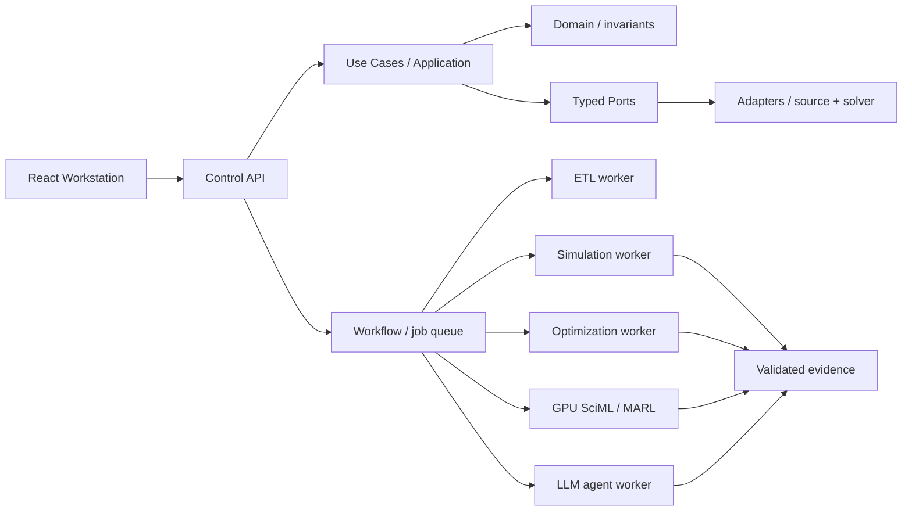

# UNITESIS Power Intelligence — Arquitectura de repositorio V4

**Fecha:** 17 de octubre de 2026. **Estado:** arquitectura física de carpetas construida, scripts de repositorio probados; **no** constituye plataforma eléctrica implementada. **Base:** `ARQUITECTURA_AVANZADA_UNITESIS_POWER_INTELLIGENCE_V3.md` (incluida como `docs/reference/ARCHITECTURE_V3_BASELINE.md`).

## 1. Decisión de arquitectura

**Monorepo modular orientado a bounded contexts**, no “microservicios en cada carpeta”: (i) aplicaciones de control y visualización; (ii) paquetes Python con arquitectura hexagonal; (iii) workers aislados para ETL, solvers, optimización, entrenamiento y agentes; (iv) esquemas y evidencia versionados; (v) Spec Kit como proceso SDD; (vi) Git worktrees fuera del repositorio para trabajos concurrentes.

Reglas: *single source of truth* para red eléctrica, snapshot inmutable, topología por terminal y fase, trazabilidad de datos, puertos para solvers, SCI-ML desacoplado, agentes sin control SCADA físico. **Las carpetas vacías son contratos de ownership y no simulan implementación.**

### Flujo técnico de ejecución



- **Control plane:** `apps/control-api`, application, orchestration, approvals.
- **Data plane:** `power-adapters`, `power-topology`, `storage`, `datasets`, `contracts`.
- **Scientific compute plane:** `workers/*`, `power-simulation`, `power-optimization`, `power-sciml`, `power-marl`.
- **Trust/evidence:** `power-evidence`, `tests/electrical-golden`, `docs/architecture`.

## 2. Árbol físico completo de archivos y directorios

Este árbol corresponde a los archivos incluidos en el ZIP; `.gitkeep` se omite para mostrar los directorios como unidades arquitectónicas.

```text
unitesis-power-intelligence/
├── .cursor/
│   └── rules/
│       ├── architecture.mdc
│       └── spec-first.mdc
├── .github/
│   ├── ISSUE_TEMPLATE/
│   │   └── feature.yml
│   ├── workflows/
│   │   └── scaffold-ci.yml
│   ├── CODEOWNERS
│   └── PULL_REQUEST_TEMPLATE.md
├── .specify/
│   └── memory/
│       └── constitution.md
├── .vscode/
│   ├── extensions.json
│   └── settings.json
├── apps/
│   ├── control-api/
│   │   ├── src/
│   │   │   └── unitesis_api/
│   │   └── README.md
│   ├── operations-console/
│   │   ├── src/
│   │   └── README.md
│   └── workstation-web/
│       ├── src/
│       │   ├── app/
│       │   ├── features/
│       │   │   ├── copilot/
│       │   │   ├── evidence/
│       │   │   ├── gis/
│       │   │   ├── one-line/
│       │   │   ├── scenario-planning/
│       │   │   └── studies/
│       │   └── shared/
│       └── README.md
├── benchmarks/
│   ├── gis-topology/
│   ├── optimization/
│   ├── power-flow/
│   ├── sciml/
│   └── short-circuit/
├── contracts/
│   ├── events/
│   ├── openapi/
│   ├── protobuf/
│   ├── schemas/
│   │   ├── avro/
│   │   └── json/
│   │       └── study-run.schema.json
│   ├── units/
│   └── README.md
├── datasets/
│   ├── authorized/
│   ├── catalogs/
│   ├── lineage/
│   ├── quality/
│   ├── splits/
│   └── synthetic/
├── docs/
│   ├── architecture/
│   │   ├── arc42/
│   │   ├── data-model/
│   │   ├── decisions/
│   │   │   ├── ADR-0001-modular-monolith-workers.md
│   │   │   ├── ADR-0002-electrical-truth.md
│   │   │   └── ADR-0003-three-representations.md
│   │   ├── deployment/
│   │   ├── threat-model/
│   │   ├── C4-OVERVIEW.md
│   │   ├── CONTRACTS-AND-EVIDENCE.md
│   │   └── MODULE-BOUNDARIES.md
│   ├── development/
│   │   ├── runbooks/
│   │   ├── BRANCHING.md
│   │   ├── DEFINITION-OF-DONE.md
│   │   ├── DEPENDENCIES.md
│   │   ├── LOCAL-SETUP-WINDOWS.md
│   │   └── SDD-WORKTREE-GUIDE.md
│   ├── operations/
│   │   ├── disaster-recovery/
│   │   └── slo/
│   ├── quality/
│   │   ├── gates/
│   │   └── metrics/
│   ├── reference/
│   │   ├── ARCHITECTURE_V3_BASELINE.md
│   │   └── REPO_ARCHITECTURE_V4.md
│   ├── research/
│   │   ├── bibliography/
│   │   └── experiments/
│   ├── standards/
│   │   ├── international/
│   │   └── peru/
│   └── traceability/
│       └── FEATURE-MAP.md
├── fixtures/
│   ├── gis-connectivity/
│   ├── ieee-test-feeders/
│   ├── invalid-inputs/
│   ├── licensed-real-samples/
│   ├── synthetic-vnrgis/
│   └── README.md
├── infra/
│   ├── compose/
│   ├── containers/
│   ├── database/
│   ├── k8s-optional/
│   ├── observability/
│   ├── policies/
│   ├── security/
│   ├── terraform-optional/
│   └── README.md
├── packages/
│   ├── python/
│   │   ├── power-adapters/
│   │   │   ├── src/
│   │   │   │   └── unitesis_adapters/
│   │   │   │       └── __init__.py
│   │   │   ├── tests/
│   │   │   ├── pyproject.toml
│   │   │   └── README.md
│   │   ├── power-agents/
│   │   │   ├── src/
│   │   │   │   └── unitesis_agents/
│   │   │   │       └── __init__.py
│   │   │   ├── tests/
│   │   │   ├── pyproject.toml
│   │   │   └── README.md
│   │   ├── power-application/
│   │   │   ├── src/
│   │   │   │   └── unitesis_application/
│   │   │   │       └── __init__.py
│   │   │   ├── tests/
│   │   │   ├── pyproject.toml
│   │   │   └── README.md
│   │   ├── power-config/
│   │   │   ├── src/
│   │   │   │   └── unitesis_config/
│   │   │   │       └── __init__.py
│   │   │   ├── tests/
│   │   │   ├── pyproject.toml
│   │   │   └── README.md
│   │   ├── power-domain/
│   │   │   ├── src/
│   │   │   │   └── unitesis_domain/
│   │   │   │       ├── __init__.py
│   │   │   │       └── models.py
│   │   │   ├── tests/
│   │   │   ├── pyproject.toml
│   │   │   └── README.md
│   │   ├── power-evidence/
│   │   │   ├── src/
│   │   │   │   └── unitesis_evidence/
│   │   │   │       └── __init__.py
│   │   │   ├── tests/
│   │   │   ├── pyproject.toml
│   │   │   └── README.md
│   │   ├── power-marl/
│   │   │   ├── src/
│   │   │   │   └── unitesis_marl/
│   │   │   │       └── __init__.py
│   │   │   ├── tests/
│   │   │   ├── pyproject.toml
│   │   │   └── README.md
│   │   ├── power-optimization/
│   │   │   ├── src/
│   │   │   │   └── unitesis_optimization/
│   │   │   │       └── __init__.py
│   │   │   ├── tests/
│   │   │   ├── pyproject.toml
│   │   │   └── README.md
│   │   ├── power-ports/
│   │   │   ├── src/
│   │   │   │   └── unitesis_ports/
│   │   │   │       └── __init__.py
│   │   │   ├── tests/
│   │   │   ├── pyproject.toml
│   │   │   └── README.md
│   │   ├── power-sciml/
│   │   │   ├── src/
│   │   │   │   └── unitesis_sciml/
│   │   │   │       └── __init__.py
│   │   │   ├── tests/
│   │   │   ├── pyproject.toml
│   │   │   └── README.md
│   │   ├── power-simulation/
│   │   │   ├── src/
│   │   │   │   └── unitesis_simulation/
│   │   │   │       └── __init__.py
│   │   │   ├── tests/
│   │   │   ├── pyproject.toml
│   │   │   └── README.md
│   │   └── power-topology/
│   │       ├── src/
│   │       │   └── unitesis_topology/
│   │       │       └── __init__.py
│   │       ├── tests/
│   │       ├── pyproject.toml
│   │       └── README.md
│   └── ts/
│       ├── api-client/
│       ├── map-engine/
│       ├── one-line-engine/
│       ├── shared-schemas/
│       └── ui-kit/
├── scripts/
│   ├── dev/
│   │   └── worktree.py
│   ├── README.md
│   └── verify_structure.py
├── specs/
│   ├── 000-repository-foundation/
│   │   ├── plan.md
│   │   ├── spec.md
│   │   └── tasks.md
│   ├── 001-vnrgis-ingestion/
│   │   ├── plan.md
│   │   ├── spec.md
│   │   └── tasks.md
│   ├── 002-new-load-impact/
│   │   └── spec.md
│   ├── 003-gis-unifilar/
│   │   └── spec.md
│   └── README.md
├── storage/
│   ├── model-registry/
│   ├── objects/
│   │   ├── bronze/
│   │   ├── gold/
│   │   ├── scientific/
│   │   └── silver/
│   ├── postgres/
│   │   └── migrations/
│   └── research-registry/
├── tests/
│   ├── bootstrap/
│   │   ├── test_boundaries.py
│   │   ├── test_contracts.py
│   │   └── test_domain.py
│   ├── contract/
│   ├── electrical-golden/
│   ├── end-to-end/
│   ├── integration/
│   ├── metamorphic/
│   ├── performance/
│   ├── property-based/
│   ├── security/
│   └── unit/
├── workers/
│   ├── agent-runtime/
│   │   └── README.md
│   ├── ingestion/
│   │   └── README.md
│   ├── ml-training/
│   │   └── README.md
│   ├── optimization/
│   │   └── README.md
│   └── simulation/
│       └── README.md
├── .editorconfig
├── .env.example
├── .gitattributes
├── .gitignore
├── AGENTS.md
├── Makefile
├── package.json
├── pnpm-workspace.yaml
├── pyproject.toml
└── README.md
```

## 3. Módulos Python y fronteras permitidas

| Paquete | Responsabilidad | Puede depender de | Prohibido |
|---|---|---|---|
| `power-domain` | equipos, terminales, snapshots, invariantes | biblioteca estándar / tipos puros | ORM, FastAPI, PyTorch, OpenDSS |
| `power-ports` | interfaces de repositorio, simulación y evidencia | domain / typing | implementación DB/solvers |
| `power-application` | casos de uso, autorizaciones y validación de comandos | domain + ports | importar drivers concretos |
| `power-adapters` | VNR-GIS/MDB/SQL/DGS/OpenDSS/Pandapower | ports + domain | inyectar supuestos invisibles |
| `power-topology` | grafo por terminal-fase, switching, topología activa | domain + contratos | asumir cercanía GIS = conexión |
| `power-simulation` | estudios de red, flujos trifásicos y fallas | ports / domain | declarar validado un estudio no contrastado |
| `power-optimization` | plan multiperiodo, Pareto y escenarios | ports + solver adaptado | declarar factibilidad solo con GA/LLM |
| `power-sciml` | PINN/GNN y evaluación OOD | datos/tensores tipados | alterar snapshot original |
| `power-marl` | MARL/CTDE en simulador restringido | simulador aislado | maniobrar red real |
| `power-agents` | LLM local, RAG y tool calling estructurado | APIs autorizadas | ejecutar código peligroso sin revisión |
| `power-evidence` | identificadores, hashes, auditoría y reportes | contratos | resultados sin versión ni procedencia |

**Regla decisiva:** el frontend y los agentes nunca deben modificar directamente la topología canónica en la base de datos. Envían comandos que crean revisiones/escenarios con controles de acceso. La red validada, su GIS y el layout unifilar son representaciones distintas.

## 4. Spec-Driven Development con GitHub Spec Kit oficial

Consulta la [documentación oficial](https://github.github.com/spec-kit/quickstart.html) y el [repositorio del proyecto](https://github.com/github/spec-kit). La integración para Cursor se llama **`cursor-agent`**, no `cursor`.

```powershell
# En Windows PowerShell, con Python 3.12+, Git y uv instalados
cd unitesis-power-intelligence
python scripts/verify_structure.py
python -m unittest discover -s tests/bootstrap -v

git init -b main
git add .
git commit -m "chore: scaffold UNITESIS monorepo"

uv tool install specify-cli
specify version
# --force puede regenerar partes del scaffold. Revisar cambios y restituir constitución.
specify init --here --integration cursor-agent --script ps --force
specify check
# Para uso de ramas gestionadas por la integración Git, si está disponible:
specify extension add git
```

En el **chat del agente Cursor** (no terminal), se ejecutan las fases disponibles de Spec Kit: **Constitution → Specify → Clarify → Plan → Checklist → Tasks → Analyze → Implement → Converge**. La sintaxis puede presentarse con guiones (`/speckit-specify`) o puntos (`/speckit.specify`) dependiendo del modo instalado y su versión. Los comandos exactos los expone la integración local.

### Especificaciones ya preparadas

- `000-repository-foundation`: acuerdos, setup, tests y CI.
- `001-vnrgis-ingestion`: ingesta VNR-GIS multiempresa con QA y bloqueo por parámetros eléctricos faltantes.
- `002-new-load-impact`: estudio de cliente grande (requiere solver operativo y validado).
- `003-gis-unifilar`: sincronización de GIS y unifilar con UUID estable.

Cada spec tiene `spec.md`; las 000 y 001 también incluyen `plan.md` y `tasks.md`. En funcionamiento real, la integración de Spec Kit puede actualizar o regenerar sus propios artefactos; **no afirmar que estos archivos fueron generados mediante CLI**, sino que son especificaciones iniciales elaboradas para arrancar el proceso.

## 5. Git Worktree: aislamiento y trabajo paralelo

La implementación propuesta usa Git nativo, con un script portable para evitar borrar trabajo sin querer. A diferencia de `git clone`, múltiples *worktrees* comparten el almacén Git del proyecto pero tienen carpetas de trabajo separadas.

```text
Proyectos/
├── unitesis-power-intelligence/          # main y constitución
└── unitesis-worktrees/
    ├── 001-vnrgis-ingestion/            # feature 001
    ├── 002-new-load-impact/            # feature 002
    └── 003-gis-unifilar/               # feature 003
```

**Modo recomendado, cuando Spec Kit crea la rama:** especificar primero en Cursor, confirmar spec, cambiar el checkout principal a `main`, enlazar rama existente (`attach`). Esto evita el conflicto por intentar crear dos veces la misma rama.

```powershell
# Luego de crear y confirmar la rama 001 con Spec Kit:
git switch main
python scripts/dev/worktree.py attach 001-vnrgis-ingestion
code -n ../unitesis-worktrees/001-vnrgis-ingestion

# Para una característica que Git administra de forma manual:
python scripts/dev/worktree.py new 004-physics-engine
# Después del PR/merge y solo si el worktree está limpio:
python scripts/dev/worktree.py remove 004-physics-engine
python scripts/dev/worktree.py list
```

**Advertencias:** `new` solo para una rama que no exista; `attach` solo si ya existe y no está actualmente checked-out en otro worktree; `remove` nunca fuerza borrado, no elimina rama, y `list` exige que el repositorio ya esté inicializado. Para borrar rama fusionada, usar Git posteriormente, tras la revisión pertinente. Un worktree no es un sandbox de seguridad para ejecutar código malicioso.

### Sobre MoureDev y extensiones

Se buscaron referencias públicas de la aproximación mencionada como “MoureDev worktree”, pero no fue posible identificar una instrucción oficial concreta atribuible a ese creador. Por tanto, se emplea la documentación de **Git**, el **Spec Kit de GitHub** y el [catálogo de extensiones de la comunidad](https://github.com/github/spec-kit/blob/main/docs/community/extensions.md). Los complementos `spec-kit-worktree` y `spec-kit-worktree-parallel` son **comunitarios**, requieren revisión de código/permisos y no se atribuyen a GitHub Spec Kit core.

## 6. Política de GitHub y calidad automatizada

- `main` protegida por **GitHub Rulesets** (debe configurarse en tu cuenta), sin push directo ni force-push.
- Pull requests vinculados a spec + pruebas + ADR si cambia contrato, infraestructura, cálculos o topología.
- Convención `NNN-feature-name` y Conventional Commits.
- `AGENTS.md` y `.cursor/rules/` guían a los asistentes; código y contratos del dominio prevalecen sobre prompts.
- `.github/CODEOWNERS` es **solo una plantilla comentada**, porque no se conocen identidades de propietarios GitHub. La revisión de dueños **no está activa** hasta configurarla.
- `scaffold-ci.yml` está realmente presente y verifica estructura y tests sin instalar librerías de solvers; los workflows futuros deben ejecutar golden engineering benchmarks, pruebas de contrato, seguridad y linters.
- **No versionar** los datos reales de empresas, volcados SQL, VNR-GIS confidenciales, pesos de modelos, `.env`, resultados Parquet ni secretos.
- Para paquetes externos usar manifiestos por subproyecto y locks generados una vez probadas versiones y compatibilidades; no inventar `uv.lock` ni `pnpm-lock.yaml`.

### Pruebas ejecutadas en esta entrega

1. Verificación de 13 archivos estructurales obligatorios: **PASS**.
2. 5 tests de bootstrap: integridad de contrato JSON, aislamiento de dominio, identificadores, hash estable y rango nominal: **PASS**.
3. Compilación de todos los `.py` del scaffold: **PASS**.
4. Git temporal: crear, enumerar, eliminar, enlazar nuevamente y rechazar nombre de rama inseguro: **PASS**.
5. **No ejecutado**: `specify init` real en equipo Windows/Cursor, ingesta de VNR-GIS real, motores físicos, entrenamiento y simulación. Son tareas futuras, no validar como funcionales.

## 7. Primera secuencia de construcción controlada

| Gate | Rama/spec | Resultado que habilita el siguiente paso |
|---|---|---|
| G0 | `000` | repo y CI/constitución estables |
| G1 | `001` | ingesta de fuentes, QA, snapshot auditable |
| G2 | `003` | GIS ↔ unifilar y grafo por terminal/fase |
| G3 | `004` | motor AC real con golden feeders y límites |
| G4 | `002` | análisis antes/después para nueva carga >200 kW |
| G5 | `005` | optimización de SED, alimentadores, DER, EV y BESS |
| G6 | `006` | GNN/PINN propia con tests OOD y error físico |
| G7 | `007-008` | MARL/LLM seguro con tools y validación externa |
| G8 | `009` | permisos, backups, rendimiento, observabilidad y despliegue |

### Definition of Done por PR

`Spec aprobada + aceptación trazada -> código tipado -> pruebas verdes -> solver golden si aplica -> auditoría de seguridad/procedencia -> revisión del ingeniero -> convergencia documentada -> PR aprobado.`

## 8. Riesgos que el árbol mitiga

| Riesgo | Control |
|---|---|
| Pinchar imports circulares entre GIS/AI/solver | dependencias hacia domain/ports, test de límites, módulos segregados |
| Reentrenar PINN como reemplazo de solver sin validación | motor determinista y evidencia de benchmarks independiente |
| Archivo VNR-GIS incompleto presentado como estudio viable | regla de bloqueo + reporte de parámetros faltantes |
| Mezclar análisis de dos agentes en el mismo checkout | worktree separado por rama/spec |
| Sobrescribir infraestructura en una migración Spec Kit | commit previo + `git diff` y restauración selectiva |
| Proliferación de microservicios inmantenibles | monolito modular inicial + workers por recursos |
| Subir datos confidenciales al GitHub | `.gitignore` + reglas de data governance; controles remotos futuros |
| “Completo” sin evidencia | acceptance tests, CI y manifest por `StudyRun` |

## 9. Fuentes técnicas verificadas (no atribuciones implícitas)

1. GitHub, **Spec Kit**, https://github.com/github/spec-kit
2. GitHub, **Spec Kit Quickstart**, https://github.github.com/spec-kit/quickstart.html
3. GitHub, **Supported integrations** (`cursor-agent`), https://github.github.com/spec-kit/reference/integrations.html
4. GitHub, **Core CLI commands**, https://github.github.com/spec-kit/reference/core.html
5. Git, **git-worktree(1)**, https://git-scm.com/docs/git-worktree.html
6. GitHub Docs, **CODEOWNERS and branch protection**, https://docs.github.com/en/repositories/managing-your-repositorys-settings-and-features/customizing-your-repository/about-code-owners
7. GitHub Spec Kit, **Community extensions**, https://github.com/github/spec-kit/blob/main/docs/community/extensions.md
8. GitHub Blog, **What are Git worktrees and why should I use them?** (2026), https://github.blog/ai-and-ml/github-copilot/what-are-git-worktrees-and-why-should-i-use-them/

**Criterio final:** esta es una estructura de repositorio y proceso de implementación efectivamente construida y comprobada en sus funciones básicas; los subsistemas de generación/transmisión/distribución/GIS/IA siguen siendo módulos por desarrollar conforme a sus especificaciones.
