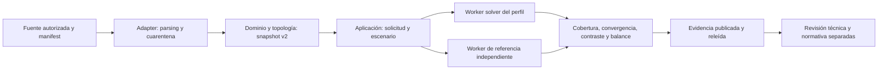

# Revisión de arquitectura — 20/10/2026

## Conclusión y alcance real

`power-intelligence` es el destino correcto como arquitectura modular, pero todavía no es una aplicación eléctrica integrada. Tiene 19 paquetes: seis con auxiliares y 13 con `__init__.py` de estructura; economía y regulación carecen de `pyproject.toml`. Los imports de los paquetes implementados son stdlib o relativos; esto demuestra aislamiento actual, no integración entre capacidades. No se ejecutaron motores ni se corrigió código de producto en esta revisión.

La auditoría previa inventarió todas las 33 raíces y 1.227.720 archivos, separando código/documentos de dependencias y cachés. La revisión actual leyó como AST las 3.492 entradas Python clasificadas como proyecto: 3.435 parseadas, seis con errores de sintaxis y 51 trasladadas antes al archivo externo. Se preservan los errores para revisión, no se eliminan como «sin aporte».

Esta revisión combina análisis estructural por archivo y lectura semántica focalizada en los siete archivos de auxiliares del núcleo y los contratos, comparador, pipeline, importador CYME, BFS, grafo radial, unidades, puertos y persistencia de donantes. No representa lectura manual profunda de 1,2 millones de archivos, ni valida formatos binarios o equivalencia funcional de todos los clones. Los 38 aportes seleccionados conservan su hash original.

## Evidencia navegable

Artefactos reproducibles del workspace: [carpeta de revisión](../../../_diagnostico_2026-10-20/arquitectura_2026-10-20/).

- [Registro Python por archivo](../../../_diagnostico_2026-10-20/arquitectura_2026-10-20/revision_python_por_archivo.csv): ruta, hash actual, imports, símbolos, líneas, ramas sintácticas, llamadas dinámicas, decisión de conservación y área destino. El destino heredado de la matriz raíz es orientativo, no una asignación semántica validada de cada archivo.
- [Decisión por las 33 raíces originales](../../../_diagnostico_2026-10-20/arquitectura_2026-10-20/revision_por_raiz.csv): ubicación actual, aporte, prioridad, Python/errores y protección frente a eliminación completa. Dos raíces están archivadas externamente; el tercer movimiento previo corresponde a una carpeta anidada.
- [Estado de los 19 módulos](../../../_diagnostico_2026-10-20/arquitectura_2026-10-20/modulos_nucleo.csv) y [sus imports](../../../_diagnostico_2026-10-20/arquitectura_2026-10-20/dependencias_nucleo.csv). «Ramas» es conteo AST de construcciones, no complejidad ciclomática ni cobertura.
- [38 aportes con SHA y gate](../../../_diagnostico_2026-10-20/arquitectura_2026-10-20/aportes_verificados.csv). Todos siguen siendo candidatos, ninguno pasa a integrado solo por esta revisión.
- [Nuevas reproducciones aisladas](../../../_diagnostico_2026-10-20/arquitectura_2026-10-20/contract_probes.json) y [F01–F04 previos](../../../_diagnostico_2026-10-20/hallazgos_reproducidos.json).
- [Plan concreto de esta intervención](../../../_diagnostico_2026-10-20/arquitectura_2026-10-20/PLAN.md) y journal de eliminación en esa misma carpeta. No reescribir los contadores de la auditoría previa.

## Hallazgos que bloquean reutilización directa

| ID / evidencia | Archivo y comportamiento observado | Resolución en spec / tarea |
|---|---|---|
| F01 reproducido | `power-regulation/pide_reference.py`, `assess_reference_case`: alternativas vacías omiten validación económica y pueden dar `documentary_complete=true` | AC02, validar fuera del bucle; I02 |
| F02 reproducido | `power-economics/core.py`, `rank_feasible_alternatives`: `technical_feasible="false"` entra al ranking | AC02, booleano estricto; I02 |
| F03 reproducido | `annual_equivalent_cost`: tasa 1e-20 admitida provoca división por cero por cancelación | AC02, anualidad estable y extremos; I02 |
| F04 reproducido | `flujos/.../validation.py`: dos resultados vacíos con convergencia true comparan como éxito | AC02/09, cobertura contra modelo esperado; I05 |
| A05 reproducido en esta revisión | `flujos/.../solvers/base.py`, `NetworkModel.validate`: frecuencia, tensión nominal y slack NaN son admitidas | AC02/03, finitud en todas las magnitudes; I03 |
| A06 reproducido en esta revisión | `power-regulation/core.py`, `check_profile_for_submission`: cadena `"false"` permite pasar la compuerta de ese auxiliar | AC02, booleano estricto y bloqueo normativo; I02. No demuestra certificación/exportación real ni un bypass integral |
| A07 reproducido en esta revisión | `flujos/.../validation.py`: tolerancia de tensión infinita permite diferencia de 1 pu | AC02/09, validar tolerancias finitas; I05 |
| A08 lectura de código, sin motor | `power-domain/models.py`: hash solo incluye source_id y equipos; no existen líneas/cargas/estados en ese modelo | AC03, evolución v2 versionada, no segundo snapshot; I03 |
| A09 lectura de código, sin motor | `flujos/.../cyme_network_builder.py`: filtra prefijo SEC_, fija R/X/ampacidad y CRS EPSG:32718, longitud y PF por defecto; descarta islas no alcanzadas | AC10, cuarentena y reconciliación de conteos; I04 |
| A10 lectura de código, sin corrida de pipeline | `flujos/open_pipeline.py`: desactiva cobertura de líneas y define production_ready solo por comparación; calidad estimada queda informativa | Estados separados y AC09/10; I05/I06 |
| A11 lectura de código | `aaac_pf/bfs_solver.py`: P/Q faltantes son cero, reemplaza tensión casi cero por nominal y tolerancia compara variación en voltios | Rechazar ausencias y estados inválidos; separar tolerancia de iteración de balance/contraste; I05 |
| A12 lectura de código | `aaac_pf/graph_model.py`: construcción sintética reparte demanda, fija temperatura 60 y PF por defecto; anotación usa sorted(nodes) frente a orden topológico del BFS | Adaptar solver, no importar generador sintético como ingesta; resultados por ID explícito y prueba de nodos arbitrarios; I03/I05 |
| A13 lectura de contratos | `gridbridge/domain/elements.py` usa Pydantic; `domain/units.py` convierte sin finitud; resultados de puertos tienen valores/cobertura por defecto | Reescribir dominio stdlib, validar unidades/resultados y no usar defaults como evidencia; I03 |
| A14 lectura y contraste | `RECYM/src/core/persisted_readback.py`: captura fresh/consulta por NetworkId, hash antes/después, publicación temporal y contraste ConnectedKVA con alcance explícito | Adoptar patrón de custodia, no convertir su relectura parcial en validación de toda MDB. Native acceptance pendiente; I04/N03 |
| A15 lectura de esquema/test | StudyRun 0.1.0 exige git_commit y estados distintos; test bootstrap solo inspecciona estructura | Nueva versión/migración y payloads reales, sin commit ficticio; I03/I04 |

Los probes A05/A07 aíslan clases y funciones puras de sus imports opcionales; no reproducen resultados reales de adaptadores. No se afirma que un motor haya producido esos casos. F01–F04 conservan sus scripts previos; A05–A07 tienen `probe_contracts.py` reproducible y salida JSON estricta.

## Evaluación de familias y aportes

| Área / raíces | Aporte que debe conservarse | Qué impide eliminar o copiar directamente |
|---|---|---|
| flujos, analiselectrico | Contratos, DGS/CYME, solvers, jobs, GIS/unifilar | Defaults, validación parcial, dominio Pydantic; pruebas independientes necesarias |
| RECYM, EVATE, CorrecionDatos | Alcance por alimentador, unidades, cambios, persistencia/readback, parsers y continuidad | Runtimes/licencias nativas; no ejecutar escrituras ni inferir catálogo a partir de continuidad |
| Prodma, informe, demandaiq | Custodia, etapas separadas, modelos/exógenas y validación temporal | No mezclar futuros con observados ni copiar datos privados; variantes y cambios Git únicos |
| SelecCablesAAAC | BFS, catálogo, dimensionamiento y economía | Modelo sintético y supuestos térmicos no son fuente de red real; validar catálogo y unidades |
| PITELD, PGE-PIT-PIDE | OOXML, auditoría, perfiles, F100/F200, demanda/pérdidas | PIT no es PIDE; dos errores sintácticos de visualización no invalidan documentos fuente |
| Electro Dunas, Proyectos de inversion, data | Backups/manuales VNR, estudios y catálogo de datasets | Fuente potencial con derechos/fecha pendientes; datos ausentes no autorizan borrar metadatos |
| GridSyncNet_Iquitos, smartgridiq2 | Familia gridsyncnet con controles adicionales en variantes | Cuatro archivos Python distintos; elegir por contrato/prueba, no por sufijo |
| smartgridiq, p2p-iquitos-v6-real-feeder | Safety, conocimientos y experimentos P2P/MARL | Fork v6 pierde funciones presentes en smartgridiq; surrogate no equivale a GridLAB-D |
| iquitos_madrl, iquitos_madrl_gridlabd_v16, iquitos_madrl_gridlabd_v1 | Co-simulación y escenarios | Python de dos versiones idéntico no elimina diferencias de config ni terceros embebidos |
| CityLearn-v3-MADRL-complete, MADRL_Citylearn_v3, MADRLCitytleranflexresdr - copia, iquitos_citylearn_project | Escenarios/algoritmos/datos y tests de edificios | Forks con cambios propios; CityLearn no valida restricciones de alimentador |
| PROJECIA | Contenedor con CityLearn/MADDPG/DDPG y variantes | Heterogéneo; solo audio salió al archivo, el resto se evalúa por componente |
| smartgridsep, geoai | Servicio de simulación, esquemas y GIS/ML externo | No duplicar plataforma; preservar licencia, GIS no prueba conectividad |
| Agentaudio, MADRL_Lima_Proyecto_v2, madrl_lima | Proyectos de objetivo independiente | Dos raíces y audio anidado archivados; madrl_lima bloqueado por permisos, restaurado; no insistir con movimiento recursivo |
| .vscode, power-intelligence | Configuración local y núcleo destino | cmake apunta a GridLAB-D vecino; no se elimina configuración sin determinar uso independiente |

El ledger raíz conserva las razones específicas para cada carpeta, incluidas las agrupadas aquí. Las conclusiones de familias se apoyan en comparación previa de contenido, no solo en este AST. Ningún archivo se considera inútil por no ser alcanzado desde un entrypoint estático: imports dinámicos, CLI, notebooks, fixtures y motores pueden depender de él.

## Flujo objetivo, todavía no implementado

## Limpieza de esta revisión

Se eliminaron 946 archivos adicionales de bytecode, temporales de bytecode y caché Numba, con 16.671.353 bytes lógicos (15,90 MiB). El plan comprobó raíz, ausencia de enlaces/reparse y archivos Git, patrones regenerables y antigüedad superior a 24 horas. El journal se escribió antes de eliminar y se verificó SHA por archivo antes de cada eliminación. No se borró código fuente ni se modificó el archivo externo anterior.

La eliminación previa fue de 286.173 archivos y 5.682.440.918 bytes lógicos. Acumulado de ambas intervenciones: 287.119 archivos y 5.699.112.271 bytes lógicos (5,31 GiB). Bytes lógicos no son medición de espacio físico recuperado. Los tres movimientos al archivo externo no liberan espacio de disco ni cuentan como eliminaciones.

No se repitió el movimiento bloqueado de madrl_lima ni se cambió ACL/procesos. Fuentes únicas, modelos, datos, licencias, worktrees y variantes de código permanecen protegidos. Estos resultados son independientes de las correcciones de producto aún pendientes en tasks.md.

## Verificación ejecutada

`verification.json` y los archivos `check_*.json` de la carpeta de revisión registran: las 946 eliminaciones ya no existen; los 3.441 Python presentes del inventario mantienen su SHA; los 38 aportes conservan su SHA; el estado de archivos versionados de diez repositorios coincide con la línea base anterior. Estructura del núcleo y registro de 24 habilidades/conectores pasan. `py -3.12 -B -m unittest discover -s tests/bootstrap -v` ejecutó 52 casos: 51 pasan y uno se omite por privilegios de symlink. Los enlaces locales y los doce IDs de aceptación del spec fueron verificados.

No se midió espacio físico liberado, cobertura dinámica ni rendimiento de motores. La deuda previa de Ruff no fue corregida; no se atribuye validez eléctrica a estos checks.

## Sustento científico

Las tesis de maestría de Gamvrinos (2020) y Faustino (2021), el doctorado de Ragkhitwetsagul (2018) y el artículo indexado de Thwe et al. (2025) respaldan la metodología de clones, migración gradual e interoperabilidad. Registros, enlaces verificados y límites de consulta están en [research.md](research.md). No prueban seguridad de un borrado concreto ni aceptación eléctrica; ambas dependen de evidencia local.
